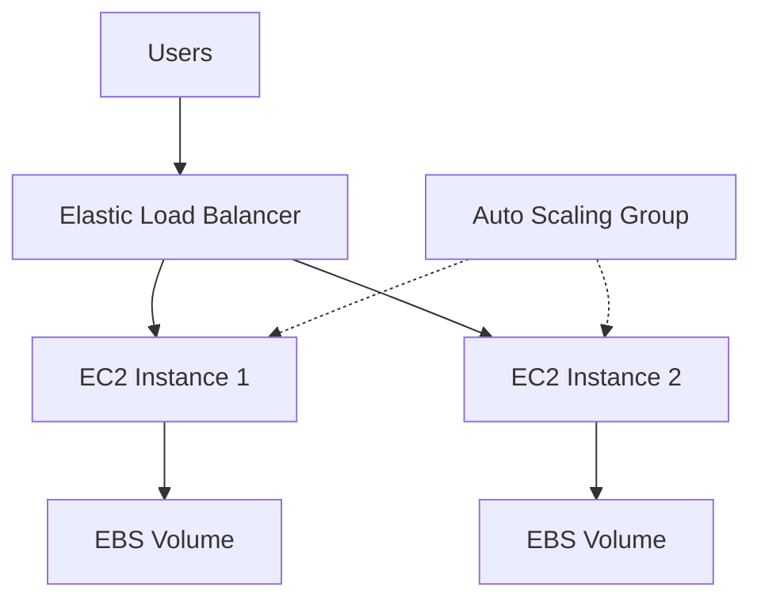
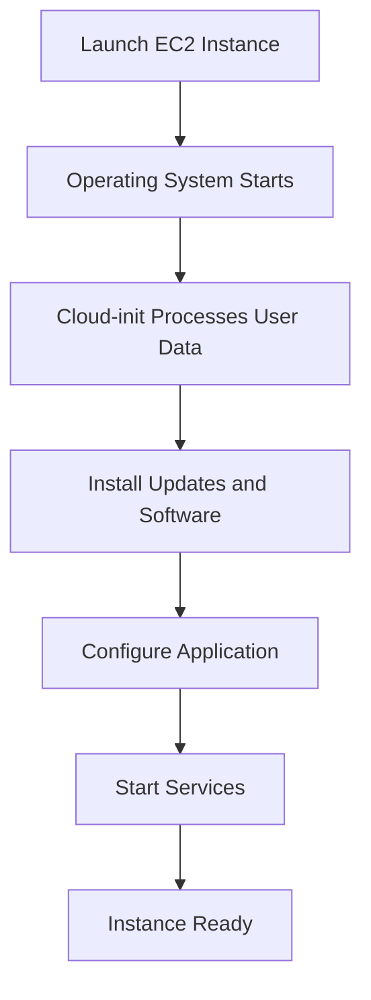
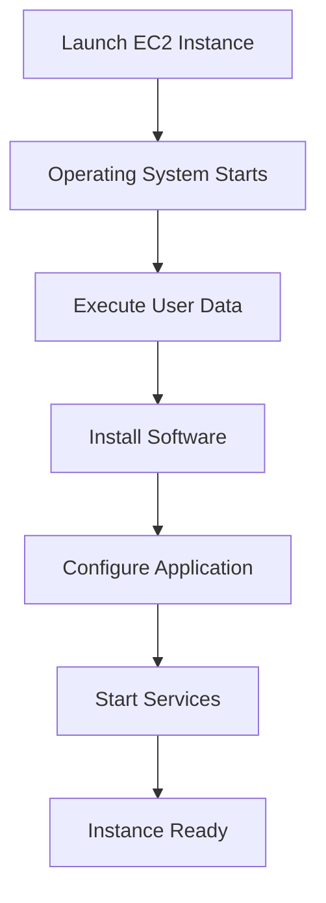
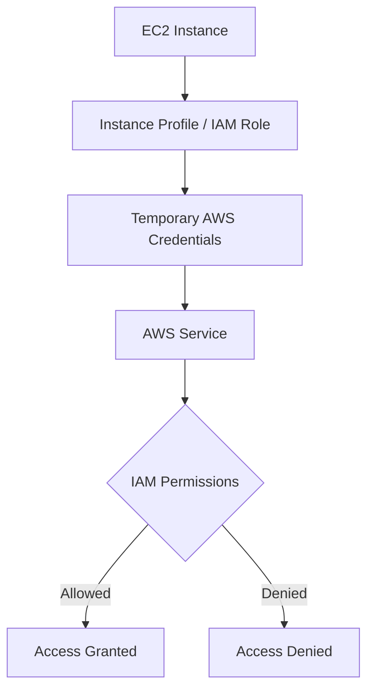

# Amazon EC2 (Elastic Compute Cloud)

## 1. Introduction to Amazon EC2

**Amazon Elastic Compute Cloud (EC2)** is one of AWS's core cloud computing services. It provides scalable virtual servers that allow users to run applications without purchasing or maintaining physical hardware.

EC2 is an example of **Infrastructure as a Service (IaaS)**, where AWS manages the underlying physical infrastructure while customers manage their virtual machines, operating systems, and applications.

### Core EC2-Related Services

| Service | Description | Purpose |
|---|---|---|
| EC2 | Elastic Compute Cloud | Rent virtual machines to run applications |
| EBS | Elastic Block Store | Store data on persistent virtual disks |
| ELB | Elastic Load Balancing | Distribute incoming traffic across multiple targets |
| ASG | Auto Scaling Group | Automatically adjust the number of EC2 instances based on demand |

These services work together to provide scalable, reliable infrastructure.

### Example Architecture



- **ELB** distributes incoming requests across EC2 instances.
- **EC2** runs the application.
- **EBS** provides persistent storage.
- **ASG** maintains and adjusts the number of EC2 instances.

Understanding EC2 is fundamental to understanding how cloud computing infrastructure works.

---

## 2. EC2 Instances

An **EC2 instance** is a virtual machine running on AWS infrastructure.

Each instance can be configured with different computing resources depending on the application's requirements.

### Instance Resources

- **vCPU:** Virtual CPU capacity used to execute instructions.
- **RAM:** Memory available for running processes.
- **Storage:** Persistent or temporary disks used to store data.
- **Networking:** Network connectivity and bandwidth.
- **Operating System:** Linux, Windows, or another supported operating system.

AWS provides multiple instance types optimized for specific workloads.

---

## 3. EC2 User Data

**EC2 User Data** allows developers to execute initialization scripts automatically when launching an EC2 instance.

This process is called **bootstrapping**.

### What Is Bootstrapping?

Bootstrapping is the process of automatically configuring a machine when it starts.

It eliminates the need to manually install software, configure dependencies, and prepare the server.

### Common Uses

EC2 User Data can automate tasks such as:

- Installing operating system updates.
- Installing software packages and dependencies.
- Downloading files from the internet.
- Configuring application environments.
- Starting application services.
- Preparing a web server.

### Important Characteristics

- User Data scripts typically execute **only once during the instance's first boot** by default on standard Linux AMIs using cloud-init.
- On these Linux instances, shell scripts normally execute with **root privileges**.
- Scripts can be configured to execute on subsequent boots.
- Behavior depends on the AMI, operating system, and initialization agent.
- User Data should not contain plaintext credentials or other sensitive secrets.

### Example: Installing a Web Server

The following User Data script installs and starts Apache on an Amazon Linux 2023 instance.

```bash
#!/bin/bash

# Update installed packages
dnf update -y

# Install Apache
dnf install -y httpd

# Start Apache
systemctl start httpd

# Enable Apache on boot
systemctl enable httpd

# Create a basic webpage
echo "<h1>Hello from Amazon EC2</h1>" \
  > /var/www/html/index.html
```

### Execution Flow



**Key concept:** EC2 User Data automates instance initialization, making it easier to deploy consistently configured servers.

---

## 4. EC2 Instance Types

AWS provides several categories of EC2 instances optimized for different computing requirements.

Choosing the correct instance type helps balance **performance, scalability, and cost**.

### Instance Type Naming Convention

AWS uses a naming convention to identify the characteristics of an EC2 instance.

Example:

`m5.2xlarge`

| Component | Value | Meaning |
|---|---|---|
| Instance family | `m` | General-purpose instance family |
| Generation | `5` | Fifth generation |
| Instance size | `2xlarge` | Resource capacity within the family |

- **Family:** Indicates the workload specialization.
- **Generation:** Identifies the hardware generation.
- **Size:** Determines the amount of CPU, RAM, and other resources available.

Generally, newer generations offer improvements in performance, efficiency, or hardware capabilities.

Larger sizes within the same family typically provide more computing resources at a higher cost.

### EC2 Instance Categories

| Category | Optimization | Common Use Cases |
|---|---|---|
| General Purpose | Balanced CPU, memory, and networking | Web applications, APIs, development environments |
| Compute Optimized | High CPU performance | Batch processing, media transcoding, compute-intensive applications |
| Memory Optimized | High RAM capacity | Databases, in-memory caching, real-time analytics |
| Storage Optimized | High local storage throughput or IOPS | Data warehouses, databases, distributed file systems |
| Accelerated Computing | GPUs and specialized accelerators | Machine learning, graphics, AI workloads |
| HPC Optimized | High-performance computing | Scientific simulations, large-scale computational workloads |

---

## 5. General Purpose Instances

**General Purpose instances** provide a balance between:

- Computing power (CPU).
- Memory (RAM).
- Networking performance.

These instances are suitable for applications that do not require extreme specialization in a single resource.

### Common Use Cases

- Web servers.
- REST APIs.
- Development and testing environments.
- Code repositories.
- Small and medium-sized applications.
- Application servers.

### Common Instance Families

| Family | Description |
|---|---|
| T | Burstable general-purpose performance |
| M | Balanced, consistent general-purpose performance |

**Example:** `t2.micro` is a general-purpose instance commonly used in introductory AWS training.

T-family instances use CPU credits to support burstable performance, making them suitable for workloads with variable CPU utilization.

---

## 6. Compute Optimized Instances

**Compute Optimized instances** are designed for workloads requiring high CPU performance.

These instances are useful when processing power is more important than having large amounts of memory.

### Common Use Cases

- Batch processing.
- Media transcoding.
- High-performance web servers.
- High-performance computing (HPC).
- Scientific modeling.
- CPU-intensive machine learning workloads.
- Dedicated gaming servers.
- Compute-intensive application servers.

### Common Instance Families

Compute-optimized instances generally belong to the **C family**.

Examples:

- `c5.large`
- `c6i.large`
- `c7i.large`

### Example

Consider an application that processes thousands of images.

Each image requires CPU-intensive operations such as resizing, compression, and format conversion.

A compute-optimized instance can provide better performance for this workload than a general-purpose instance with similar pricing.

**Key concept:** Choose compute-optimized instances when CPU processing is the primary performance bottleneck.

---

## 7. Memory Optimized Instances

**Memory Optimized instances** provide large amounts of RAM for applications that process substantial datasets in memory.

These instances help reduce expensive disk operations by keeping frequently accessed information in RAM.

### Common Use Cases

- High-performance relational databases.
- NoSQL databases.
- Distributed caching systems.
- In-memory databases.
- Business intelligence applications.
- Real-time processing of large unstructured datasets.
- Large-scale data analysis.

### Common Instance Families

| Family | Description |
|---|---|
| R | Memory-optimized instances for data-intensive applications |
| X | High-memory configurations for demanding workloads |

### Example: In-Memory Caching

Consider an application using Redis to cache frequently accessed database results.

Redis stores data primarily in memory to provide low-latency access.

A memory-optimized EC2 instance can support larger datasets and more memory-intensive workloads.

**Key concept:** Choose memory-optimized instances when RAM capacity or memory performance is the primary requirement.

---

## 8. Storage Optimized Instances

**Storage Optimized instances** are designed for workloads requiring high-performance access to large datasets stored on local storage.

These workloads may depend on:

- High sequential read/write throughput.
- High random I/O performance.
- Low storage latency.
- Fast access to large datasets.

### Common Use Cases

- High-frequency Online Transaction Processing (OLTP) systems.
- Relational and NoSQL databases.
- Data warehousing applications.
- Distributed file systems.
- Storage-intensive analytics.
- Local caching for data-intensive applications.

### Common Instance Families

| Family | Description |
|---|---|
| I | High-performance local SSD storage with strong IOPS capabilities |
| D | Dense storage configurations optimized for large datasets |
| H | High-throughput HDD storage workloads |

### Understanding IOPS

**IOPS (Input/Output Operations Per Second)** measures how many read or write operations a storage system can perform each second.

Storage performance is commonly evaluated using:

- **IOPS:** Number of operations per second.
- **Throughput:** Amount of data transferred per second.
- **Latency:** Time required to complete an operation.

### Example

A database processing thousands of transactions per second may require very fast access to locally stored data.

A storage-optimized instance can provide the necessary disk performance.

**Important:** Local instance storage is generally ephemeral. Data that must survive instance termination should be stored in a durable storage service, such as EBS, according to the application's requirements.

---

## 9. Accelerated Computing and HPC Instances

### Accelerated Computing

Accelerated Computing instances use specialized hardware, such as GPUs or AI accelerators, to perform certain operations more efficiently than standard CPUs.

Common workloads include:

- Machine learning training.
- AI inference.
- Graphics rendering.
- Video processing.
- Scientific computations.

Examples include AWS G and P instance families.

### HPC Optimized

**High-Performance Computing (HPC)** instances are optimized for computationally demanding workloads that may require high CPU performance, memory bandwidth, and efficient communication between machines.

Common workloads include:

- Scientific simulations.
- Computational fluid dynamics.
- Weather modeling.
- Large-scale engineering calculations.

---

## 10. Comparing EC2 Instance Types

| Workload | Recommended Category | Primary Resource |
|---|---|---|
| React/Node.js web application | General Purpose | Balanced CPU and RAM |
| CPU-intensive image processing | Compute Optimized | CPU |
| Redis caching server | Memory Optimized | RAM |
| High-performance database with intensive local I/O | Storage Optimized | Storage IOPS and throughput |
| AI model training | Accelerated Computing | GPU or AI accelerator |
| Scientific simulation | HPC Optimized | Compute and networking |

### How to Choose an Instance Type

The choice depends on the application's bottleneck:

1. **CPU bottleneck:** Consider Compute Optimized.
2. **Memory bottleneck:** Consider Memory Optimized.
3. **Disk I/O bottleneck:** Consider Storage Optimized.
4. **Balanced resource usage:** Consider General Purpose.
5. **GPU or specialized processing:** Consider Accelerated Computing.
6. **Scientific computing at scale:** Consider HPC Optimized.

Instance selection should also consider cost, availability, architecture compatibility, and expected traffic.

---

## 11. Key Concepts for AWS Certification

- **EC2** provides virtual machines as an Infrastructure as a Service offering.
- **EBS** provides persistent block storage for EC2 instances.
- **ELB** distributes incoming traffic across multiple targets.
- **ASG** automatically adjusts EC2 capacity.
- **User Data** automates instance configuration during initialization.
- **Bootstrapping** means automatically running configuration tasks during startup.
- **General Purpose** instances balance CPU, RAM, and networking.
- **Compute Optimized** instances prioritize CPU performance.
- **Memory Optimized** instances prioritize RAM.
- **Storage Optimized** instances prioritize storage throughput and IOPS.
- **Accelerated Computing** instances provide GPUs or specialized accelerators.
- **HPC Optimized** instances support demanding computational workloads.
- **Instance naming** identifies the family, generation, and size.
- **The correct instance type depends on the application's resource requirements.**

# Amazon EC2 (Elastic Compute Cloud)

## 1. Introduction to Amazon EC2

**Amazon Elastic Compute Cloud (EC2)** is an AWS service that provides scalable virtual servers in the cloud.

EC2 is an example of **Infrastructure as a Service (IaaS)**. AWS manages the physical infrastructure, while customers manage their virtual machines, operating systems, and applications.

### Core EC2-Related Services

| Service | Description | Purpose |
|---|---|---|
| EC2 | Elastic Compute Cloud | Rent virtual machines |
| EBS | Elastic Block Store | Store data on persistent virtual disks |
| ELB | Elastic Load Balancing | Distribute traffic across multiple targets |
| ASG | Auto Scaling Group | Automatically adjust the number of EC2 instances |

These services work together to build scalable and reliable cloud applications.

### EC2 Instance Resources

An EC2 instance is a virtual machine with configurable resources:

- **vCPU:** Virtual processing capacity.
- **RAM:** Memory available to applications.
- **Storage:** Persistent or temporary disk storage.
- **Networking:** Network connectivity and bandwidth.
- **Operating System:** Linux, Windows, or other supported systems.

---

## 2. Amazon Machine Images (AMI)

An **Amazon Machine Image (AMI)** is a template containing the information required to launch an EC2 instance.

An AMI typically includes:

- Operating system.
- Software packages and dependencies.
- Root volume configuration.
- Launch permissions.

### AMI Types

- **AWS-provided AMIs:** Published and maintained by AWS.
- **Marketplace AMIs:** Provided by third-party vendors.
- **Custom AMIs:** Created from existing instance configurations.

Custom AMIs allow developers to launch multiple instances with consistent software configurations.

---

## 3. EC2 User Data

**EC2 User Data** allows developers to execute initialization scripts automatically when launching EC2 instances.

This process is known as **bootstrapping**.

### What Is Bootstrapping?

Bootstrapping is the process of automatically configuring a machine during startup.

It can be used to:

- Install operating system updates.
- Install software and dependencies.
- Download files from the internet.
- Configure application environments.
- Start application services.
- Prepare web servers.

### Important Characteristics

- By default, User Data shell scripts normally run only during the first boot on standard Linux AMIs using cloud-init.
- On these Linux instances, scripts typically execute with **root privileges**.
- Scripts can be configured to execute on subsequent boots.
- Behavior can differ depending on the operating system and initialization agent.
- Sensitive credentials should not be stored in User Data.

### Example: Install Apache on Amazon Linux 2023

```bash
#!/bin/bash

# Update packages
dnf update -y

# Install Apache
dnf install -y httpd

# Start Apache
systemctl start httpd

# Enable Apache at startup
systemctl enable httpd

# Create a webpage
echo "<h1>Hello from EC2</h1>" > /var/www/html/index.html
```

### Bootstrapping Workflow



---

## 4. EC2 Instance Types

AWS provides several instance families optimized for specific workloads.

Choosing the correct instance type helps balance **performance, scalability, and cost**.

### Instance Naming Convention

Example: `m5.2xlarge`

| Component | Value | Meaning |
|---|---|---|
| Family | `m` | General Purpose |
| Generation | `5` | Fifth generation |
| Size | `2xlarge` | Capacity within the instance family |

- **Family:** Indicates the instance's specialization.
- **Generation:** Identifies the hardware generation.
- **Size:** Determines the resources available within the family.

Newer generations generally improve performance or efficiency.

### EC2 Instance Categories

| Category | Optimization | Common Uses |
|---|---|---|
| General Purpose | Balanced CPU, RAM, networking | Web applications, APIs |
| Compute Optimized | CPU performance | Batch processing, media transcoding |
| Memory Optimized | RAM capacity | Databases, caching |
| Storage Optimized | Storage IOPS and throughput | Data warehouses, databases |
| Accelerated Computing | GPUs and specialized hardware | AI, machine learning, graphics |
| HPC Optimized | High-performance computation | Scientific simulations |

### 4.1 General Purpose

General Purpose instances balance:

- Computing power.
- Memory.
- Networking.

Common uses include web servers, REST APIs, development environments, and application servers.

**Common families:** T and M.

Example: `t2.micro`

T-family instances support burstable CPU performance through CPU credits.

### 4.2 Compute Optimized

Designed for CPU-intensive applications.

Common uses:

- Batch processing.
- Media transcoding.
- High-performance web servers.
- Scientific modeling.
- CPU-intensive machine learning.
- Dedicated gaming servers.

**Common family:** C.

Example: `c5.large`

### 4.3 Memory Optimized

Designed for applications requiring large amounts of RAM.

Common uses:

- Relational and NoSQL databases.
- Redis and distributed caches.
- In-memory databases.
- Business intelligence.
- Real-time processing of large datasets.

**Common families:** R and X.

### 4.4 Storage Optimized

Designed for applications requiring high-performance local storage.

Common uses:

- High-frequency Online Transaction Processing (OLTP).
- Relational and NoSQL databases.
- Data warehousing.
- Distributed file systems.
- Storage-intensive analytics.

**Common families:** I, D, and H.

Important storage metrics:

- **IOPS:** Input/output operations per second.
- **Throughput:** Amount of data transferred per second.
- **Latency:** Time required to complete an operation.

### 4.5 Accelerated Computing

Uses specialized hardware such as GPUs or AI accelerators.

Common uses:

- Machine learning training.
- AI inference.
- Graphics rendering.
- Video processing.

**Common families:** G and P.

### 4.6 HPC Optimized

Designed for high-performance computational workloads.

Common uses:

- Scientific simulations.
- Weather modeling.
- Engineering calculations.
- Computational fluid dynamics.

### Instance Selection Summary

| Application | Recommended Category |
|---|---|
| React/Node.js web application | General Purpose |
| CPU-intensive image processing | Compute Optimized |
| Redis cache | Memory Optimized |
| High-performance local database storage | Storage Optimized |
| AI model training | Accelerated Computing |
| Scientific simulation | HPC Optimized |

---

## 5. EC2 Storage

EC2 supports persistent and temporary storage.

### 5.1 Amazon EBS (Elastic Block Store)

**EBS** provides persistent block storage for EC2 instances.

Characteristics:

- Data survives instance stops and starts.
- EBS volumes can be attached to compatible instances.
- Supports snapshots for backup and recovery.
- Commonly used for operating systems, applications, and databases.

### 5.2 Instance Store

**Instance Store** provides temporary storage physically attached to the host running the instance.

Characteristics:

- High-performance local storage.
- Data does not survive instance stops or termination.
- Suitable for caches and temporary processing.

| Feature | EBS | Instance Store |
|---|---|---|
| Persistence | Persistent | Temporary |
| Survives stopping | Yes | No |
| Snapshots | Supported | Not directly supported |
| Typical use | OS, applications, databases | Cache, temporary files |

---

## 6. EC2 Security Groups

### 6.1 What Are Security Groups?

**Security Groups** are a fundamental component of network security in AWS.

A Security Group acts as a **virtual firewall** that controls network traffic entering and leaving EC2 instances.

Security Groups control:

- Access to network ports.
- Authorized IPv4 and IPv6 address ranges.
- Incoming network traffic (inbound).
- Outgoing network traffic (outbound).

### 6.2 Inbound and Outbound Traffic

**Inbound traffic** refers to network traffic entering an EC2 instance.

Example: A user accesses a web application hosted on EC2 through HTTPS.

**Outbound traffic** refers to network traffic leaving an EC2 instance.

Example: An EC2 instance downloads a dependency from an external server.


### 6.3 Security Group Rules

Security Groups use rules to determine which network connections are permitted.

Rules define:

- **Protocol:** TCP, UDP, ICMP, etc.
- **Port or port range:** Network ports that can be accessed.
- **Source:** Origin of inbound traffic.
- **Destination:** Target of outbound traffic.
- **Description:** Optional explanation of the rule.

A rule can reference:

- IPv4 addresses or CIDR ranges.
- IPv6 addresses or CIDR ranges.
- Other Security Groups, where supported.

**Important:** Security Groups contain only **allow rules**. They do not support explicit deny rules.

Traffic not permitted by a rule is implicitly denied.

### 6.4 Example Security Group Rules

| Type | Protocol | Port | Source | Purpose |
|---|---|---|---|---|
| HTTP | TCP | 80 | `0.0.0.0/0` | Public website |
| SSH | TCP | 22 | `122.149.196.85/32` | SSH from one IP address |
| Custom TCP | TCP | 4567 | `0.0.0.0/0` | Custom application |

### Understanding CIDR Notation

**CIDR (Classless Inter-Domain Routing)** defines an IP address or range of addresses.

Examples:

- `0.0.0.0/0`: All IPv4 addresses.
- `::/0`: All IPv6 addresses.
- `192.168.1.0/24`: IPv4 range from `192.168.1.0` through `192.168.1.255`.
- `122.149.196.85/32`: A single IPv4 address.

**Security recommendation:** Avoid exposing administrative ports such as SSH (22) to the entire internet.

### 6.5 Default Security Group Behavior

For a newly created Security Group:

- **Inbound:** No traffic is allowed by default.
- **Outbound:** All traffic is allowed by default.

These rules can be modified.

A VPC's automatically created **default Security Group** is different: it initially allows inbound traffic from resources associated with that same Security Group.

### 6.6 Security Groups Are Stateful

Security Groups are **stateful firewalls**.

This means response traffic for an allowed connection is automatically permitted.

Example:

1. An EC2 instance sends an HTTP request to an external server.
2. The Security Group allows the outgoing request.
3. The external server sends a response.
4. The response is automatically allowed as part of the established connection.

You do not need to create a separate inbound rule for that response.

### 6.7 Important Security Group Characteristics

- A Security Group can be associated with multiple EC2 instances.
- An EC2 instance can have multiple Security Groups.
- Security Groups belong to a specific VPC within an AWS Region.
- They filter traffic at the network interface level.
- Traffic blocked by a Security Group does not reach the operating system.
- Rules can reference another Security Group rather than specific IP addresses.
- Changes to Security Group rules are applied to associated resources without requiring a restart.

When multiple Security Groups are attached, their allow rules are combined.

### 6.8 SSH Access Best Practices

SSH allows administrators to connect remotely to Linux servers.

It is good practice to maintain a separate Security Group for SSH access.

Example:

| Type | Port | Source |
|---|---|---|
| SSH | 22 | Your public IP `/32` |

This limits administrative access to trusted locations.

### 6.9 Troubleshooting Security Groups

Two common errors provide clues about connectivity problems.

**Connection Timed Out**

A timeout means the client did not receive the expected network response.

Possible causes:

- Security Group blocking traffic.
- Network ACL restrictions.
- Routing problems.
- Instance unavailable.
- Firewall blocking traffic.

**Connection Refused**

A connection-refused error generally means the destination rejected the connection.

Possible causes:

- Application is not running.
- Application is not listening on the expected port.
- Operating-system firewall rejecting the connection.

A timeout does not always indicate a Security Group problem, and connection refusal does not always indicate an application problem.

---

## 7. EC2 Instance Connect

### 7.1 What Is EC2 Instance Connect?

**EC2 Instance Connect** is an AWS feature that allows users to connect securely to supported EC2 instances using SSH authentication integrated with IAM permissions.

One common method allows users to open an SSH terminal directly from the AWS Management Console.

### 7.2 How EC2 Instance Connect Works

When connecting to a supported Linux instance:

1. The user requests a connection.
2. AWS checks the user's IAM permissions.
3. A temporary SSH public key is made available to the instance.
4. The instance uses the key to authenticate the SSH connection.
5. The user accesses the instance through a terminal.

The temporary public key is available for approximately **60 seconds** for authentication. This does not limit an established SSH session to 60 seconds.

### 7.3 Requirements

Depending on the connection method:

- A compatible EC2 instance.
- EC2 Instance Connect software configured on the instance.
- Appropriate IAM permissions.
- Correct network connectivity and Security Group rules.
- SSH access through a public connection path or EC2 Instance Connect Endpoint.

### 7.4 Connecting Through AWS Console

1. Open the AWS Management Console.
2. Navigate to **EC2 → Instances**.
3. Select the desired instance.
4. Click **Connect**.
5. Select **EC2 Instance Connect**.
6. Configure the connection settings.
7. Click **Connect** to open the terminal.

### 7.5 EC2 Instance Connect vs Traditional SSH

| Feature | EC2 Instance Connect | Traditional SSH |
|---|---|---|
| Authentication | Temporary public key with IAM-controlled access | SSH key or other configured SSH authentication |
| Browser-based terminal | Supported | Requires separate browser tooling |
| Long-term private key management | Not required for standard console connection | Usually required for key-based authentication |
| IAM integration | Yes | Not inherently |
| Network connectivity | Required | Required |

**Important:** EC2 Instance Connect does not automatically bypass network restrictions. An EC2 Instance Connect Endpoint can provide a connection path to private instances without requiring a public IP address.

---

## 8. IAM Roles for EC2

### 8.1 What Is an IAM Role?

An **IAM Role** is an AWS identity containing permissions that can be assumed by authorized entities.

EC2 instances can use IAM Roles to access AWS services securely without storing long-term access keys in application code.

### 8.2 Why Use IAM Roles?

An application running on EC2 may need to interact with services such as:

- Amazon S3.
- Amazon DynamoDB.
- Amazon SQS.
- Amazon CloudWatch.

Instead of storing permanent AWS credentials, the instance can obtain **temporary security credentials** through an attached IAM Role.

### 8.3 How EC2 IAM Roles Work



The application typically uses an AWS SDK, which automatically retrieves credentials through the EC2 Instance Metadata Service.

### 8.4 Example: Accessing S3 from EC2

Suppose a Node.js application running on EC2 needs to read files from an S3 bucket.

The recommended approach is:

1. Create an IAM Role trusted by the EC2 service.
2. Attach an IAM policy granting the required S3 permissions.
3. Associate the role with the EC2 instance through an instance profile.
4. Use the AWS SDK to interact with S3.

Example:

```javascript
import { S3Client, ListObjectsV2Command } from "@aws-sdk/client-s3";

const s3 = new S3Client({
  region: "us-east-1"
});

const response = await s3.send(
  new ListObjectsV2Command({
    Bucket: "my-example-bucket"
  })
);

console.log(response.Contents);
```

No access keys are explicitly provided in the application.

The AWS SDK uses the default credential provider chain, which can retrieve temporary credentials from the instance's IAM Role.

### 8.5 IAM Role vs Security Group

| Feature | IAM Role | Security Group |
|---|---|---|
| Purpose | Control AWS API permissions | Control network traffic |
| Security type | Identity and access management | Network security |
| Example | Allow EC2 to read an S3 bucket | Allow HTTP traffic on port 80 |
| Controls | AWS actions and resources | Protocols, ports, IP ranges |

**Key distinction:** IAM Roles control what AWS API actions an application can perform, while Security Groups control which network connections are allowed.

### 8.6 Best Practices

- Use IAM Roles instead of hardcoded credentials.
- Apply the **principle of least privilege**.
- Grant only the permissions the application requires.
- Prefer temporary credentials.
- Review and audit IAM policies regularly.
- Protect access to the Instance Metadata Service, preferably using IMDSv2.

---

## 9. EC2 Purchasing Options

AWS offers several purchasing models to optimize EC2 costs based on workload requirements.

### 9.1 On-Demand Instances

**On-Demand Instances** allow customers to pay for computing capacity without a long-term commitment.

Characteristics:

- No long-term commitment.
- Pay for the compute capacity consumed.
- Flexible scaling.
- Suitable for unpredictable workloads.

Common uses:

- Development environments.
- Short-term applications.
- Applications with unpredictable traffic.
- Testing and experimentation.

**Example:** Running a temporary API server during development.

### 9.2 Reserved Instances

**Reserved Instances (RIs)** provide billing discounts in exchange for a one-year or three-year commitment to specified EC2 usage characteristics.

Characteristics:

- Lower effective cost than On-Demand for eligible sustained usage.
- One-year or three-year terms.
- Standard and Convertible options.
- Regional RIs provide billing discounts but do not reserve specific Availability Zone capacity.
- Zonal RIs can provide capacity reservation benefits.

Common uses:

- Stable production applications.
- Predictable workloads.
- Long-running servers.

**Important:** A Reserved Instance is primarily a billing commitment rather than a separate physical instance type.

### 9.3 Savings Plans

**Savings Plans** provide discounted compute pricing in exchange for committing to a consistent amount of usage, measured in dollars per hour.

Common EC2-related options:

- **Compute Savings Plans:** More flexibility across instance families, Regions, and eligible compute services.
- **EC2 Instance Savings Plans:** Discounts tied to an instance family within a specific Region.

Savings Plans generally require a one-year or three-year commitment.

### 9.4 Spot Instances

**Spot Instances** allow customers to use spare AWS EC2 capacity at discounted prices.

Characteristics:

- Can be significantly cheaper than On-Demand.
- Capacity availability changes.
- Instances may be interrupted by AWS.
- Most Spot interruptions provide a two-minute warning.

Common uses:

- Batch processing.
- Background jobs.
- Fault-tolerant applications.
- Data processing.
- Distributed workloads that support retries.

**Example:** Processing a large collection of images where interrupted jobs can be resumed.

Spot Instances are generally not ideal for critical workloads that cannot tolerate interruptions.

### 9.5 Dedicated Hosts

**Dedicated Hosts** provide physical servers dedicated to a single AWS customer.

Common uses:

- Software licensing requirements.
- Regulatory requirements.
- Workloads requiring visibility into host-level placement.

A Dedicated Host allows customers to control instance placement on dedicated physical hardware.

### 9.6 Dedicated Instances

**Dedicated Instances** run on hardware dedicated to a single customer account, but AWS manages their physical host placement.

They provide hardware isolation without the same host-level visibility and control as Dedicated Hosts.

### 9.7 Capacity Reservations

**On-Demand Capacity Reservations** reserve EC2 capacity in a specific Availability Zone.

Characteristics:

- Ensure eligible instance capacity is available when required.
- Can be used with suitable billing discounts, such as Savings Plans.
- Typically charged for reserved capacity even when it is not being used.

Capacity Reservations are primarily used for capacity assurance, not automatic cost savings.

### 9.8 Purchasing Options Comparison

| Option | Commitment | Interruption Risk | Best For |
|---|---|---|---|
| On-Demand | None | Standard service availability | Flexible workloads |
| Reserved Instances | 1 or 3 years | No Spot-style reclamation | Predictable workloads |
| Savings Plans | 1 or 3 years | No Spot-style reclamation | Consistent compute usage |
| Spot | None | Can be interrupted | Fault-tolerant workloads |
| Dedicated Hosts | Depends on purchase arrangement | No Spot-style reclamation | Licensing and compliance |
| Dedicated Instances | No required long-term commitment | No Spot-style reclamation | Hardware isolation |
| Capacity Reservations | No required long-term commitment for On-Demand reservations | Capacity reserved | Guaranteed capacity availability |

### Choosing the Right Purchasing Option

- **Unpredictable workloads:** On-Demand.
- **Consistent long-term workloads:** Savings Plans or Reserved Instances.
- **Interruptible workloads:** Spot Instances.
- **Software licensing requirements:** Dedicated Hosts.
- **Strict hardware isolation:** Dedicated Instances or Dedicated Hosts.
- **Guaranteed capacity needs:** On-Demand Capacity Reservations.

---

## 10. EC2 Instance Lifecycle

EC2 instances transition through several states.

| State | Description |
|---|---|
| Pending | Instance is launching |
| Running | Instance is operational |
| Stopping | Instance is shutting down |
| Stopped | Instance is powered off |
| Shutting-down | Instance is being terminated |
| Terminated | Instance has been permanently removed |

### Stop vs Terminate

**Stopping an instance:**

- Shuts down the instance.
- Preserves attached EBS volumes, subject to their lifecycle settings.
- Stops ordinary instance compute charges while stopped.
- EBS storage and other allocated resources may continue generating charges.

**Terminating an instance:**

- Permanently removes the instance.
- Deletes EBS volumes configured with `DeleteOnTermination`.
- Does not automatically delete every attached storage resource.

---

## 11. Key Concepts for AWS Certification

### EC2 Fundamentals

- EC2 provides virtual machines using the IaaS model.
- EBS provides persistent block storage.
- Instance Store provides temporary local storage.
- ELB distributes incoming traffic across targets.
- ASG automatically adjusts instance capacity.
- AMIs are templates used to launch EC2 instances.
- User Data automates startup configuration tasks.

### Instance Types

- General Purpose: Balanced computing resources.
- Compute Optimized: CPU-intensive workloads.
- Memory Optimized: RAM-intensive workloads.
- Storage Optimized: High-performance local storage.
- Accelerated Computing: GPUs and specialized accelerators.
- HPC Optimized: Large-scale computational workloads.

### Security Groups

- Act as virtual firewalls.
- Control inbound and outbound network traffic.
- Support allow rules only.
- Are stateful.
- Can be attached to multiple instances.
- Belong to a VPC within an AWS Region.
- Newly created Security Groups deny inbound traffic by default and generally allow outbound traffic by default.
- Rules can reference IP ranges or other Security Groups.

### EC2 Access and IAM

- SSH commonly uses port 22.
- HTTP uses port 80.
- HTTPS uses port 443.
- EC2 Instance Connect provides IAM-integrated SSH access.
- IAM Roles provide temporary AWS credentials to EC2 instances.
- IAM Roles control AWS API permissions, not network firewall rules.
- Instance profiles are used to associate IAM Roles with EC2.

### Purchasing Options

- **On-Demand:** Flexible usage without long-term commitment.
- **Reserved Instances:** Discounts for eligible committed usage.
- **Savings Plans:** Discounts for committed compute spending.
- **Spot:** Discounted spare capacity that can be interrupted.
- **Dedicated Hosts:** Dedicated physical servers.
- **Dedicated Instances:** Single-customer hardware isolation.
- **Capacity Reservations:** Reserve compute capacity in an Availability Zone.

- **IaaS (Infrastructure as a Service):** AWS provides virtual servers through EC2.
- **SSH (Secure Shell):** Securely connect to EC2 instances to execute commands remotely.
- **EBS Volume (Elastic Block Store):** Persistent virtual storage attached to EC2 instances.