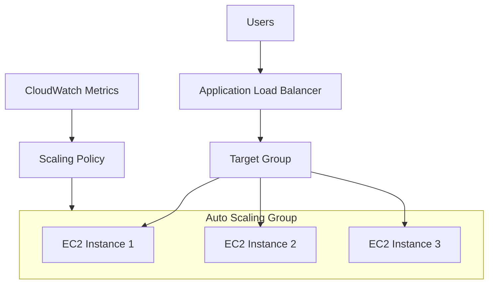

# AWS EC2: Elastic Load Balancing and Auto Scaling

## 1. What Is Load Balancing?

**Load balancing** distributes incoming traffic across multiple servers, such as EC2 instances, to improve performance, scalability, and availability.

Instead of connecting directly to individual servers, users connect to a **Load Balancer**, which forwards requests to available servers.

### Benefits

- **Traffic distribution:** Spreads requests across multiple servers.
- **High availability:** Reduces downtime when individual servers fail.
- **Health checks:** Identifies unhealthy instances.
- **Single entry point:** Provides one DNS endpoint for an application.
- **SSL/TLS termination:** Handles HTTPS encryption and decryption.
- **Session stickiness:** Directs requests from the same client to the same server when needed.
- **Multi-AZ support:** Distributes traffic across Availability Zones.
- **Public/private traffic:** Supports internet-facing and internal architectures.

## 2. AWS Elastic Load Balancing (ELB)

**Elastic Load Balancing (ELB)** is an AWS-managed service that distributes incoming traffic across multiple targets.

AWS manages the infrastructure, maintenance, scaling capacity, and high availability of the load balancer.

### AWS Integrations

- **EC2:** Virtual servers that process requests.
- **Auto Scaling Groups:** Automatically add or remove EC2 instances.
- **Amazon ECS:** Runs containerized applications.
- **AWS Certificate Manager (ACM):** Manages SSL/TLS certificates.
- **Amazon CloudWatch:** Monitors performance metrics.
- **Amazon Route 53:** Provides DNS routing.
- **AWS WAF:** Protects supported load balancers against web attacks.
- **AWS Global Accelerator:** Improves global traffic routing.

## 3. Types of AWS Load Balancers

| Type | OSI Layer | Protocols | Main Use |
|---|---|---|---|
| Application Load Balancer (ALB) | Layer 7 | HTTP, HTTPS, WebSocket | Websites, APIs, microservices |
| Network Load Balancer (NLB) | Layer 4 | TCP, UDP, TLS | High-performance network traffic |
| Gateway Load Balancer (GWLB) | Layer 3 | IP packets via GENEVE | Firewalls and security appliances |
| Classic Load Balancer (CLB) | Layers 4 and 7 | HTTP, HTTPS, TCP, SSL | Legacy applications |

**Key differences:**

- **ALB:** Routes requests using HTTP information, such as URLs and headers.
- **NLB:** Routes network connections with extremely low latency.
- **GWLB:** Routes traffic through security appliances.
- **CLB:** Previous-generation load balancer.

### Internal vs. Internet-Facing

- **Internet-facing:** Accepts traffic from the internet.
- **Internal:** Provides private access within connected networks.

## 4. Health Checks

**Health checks** determine whether backend targets are healthy enough to receive traffic.

### How They Work

1. The load balancer checks a configured endpoint.
2. The application responds.
3. The response is evaluated against configured success criteria.
4. After enough consecutive failures, the target is marked unhealthy.
5. Traffic is normally redirected to healthy targets.

### Example

```text
Protocol: HTTP
Port: 4567
Endpoint: /health
Expected status: 200 OK
```

```javascript
app.get("/health", (req, res) => {
  res.status(200).json({ status: "healthy" });
});
```

**Important:**

- HTTP health checks commonly expect a `200 OK` response.
- Accepted success codes are configurable.
- Health checks are configured through target groups.
- Unhealthy targets can return to service after passing health checks.

## 5. Load Balancer Security Groups

**Security Groups** act as virtual firewalls that control incoming and outgoing traffic.

### Load Balancer Security Group

| Protocol | Port | Source |
|---|---|---|
| HTTP | 80 | `0.0.0.0/0` |
| HTTPS | 443 | `0.0.0.0/0` |

### EC2 Security Group

| Protocol | Port | Source |
|---|---|---|
| HTTP | 80 | Load Balancer Security Group |

This configuration allows public traffic to reach the load balancer while restricting direct access to application instances on the configured port.

## 6. Application Load Balancer (ALB)

An **Application Load Balancer** operates at **Layer 7 (Application Layer)**.

It understands HTTP requests and can route them using application-level information.

### Features

- Supports HTTP, HTTPS, HTTP/2, and WebSocket.
- Routes traffic based on URL paths, hostnames, headers, and query strings.
- Supports HTTP-to-HTTPS redirects.
- Integrates with Amazon ECS and containerized applications.
- Routes requests to multiple target groups.

### Routing Examples

| Routing Type | Example | Destination |
|---|---|---|
| Path | `/users` | Users service |
| Path | `/posts` | Posts service |
| Hostname | `api.example.com` | API service |
| Query | `?role=admin` | Admin backend |
| Header | `X-App-Version: v2` | Version 2 application |

### ALB Target Groups

A **Target Group** contains backend resources receiving traffic.

Supported target types:

- **EC2 Instances:** Virtual servers.
- **IP Addresses:** Supported private IP endpoints.
- **Lambda Functions:** Serverless functions.

Amazon ECS tasks can use instance or IP target types.

### Important Components

- **Listener:** Accepts requests on a configured protocol and port.
- **Listener Rule:** Determines where a request should be routed.
- **Target Group:** Contains the registered backend resources.

### DNS and Client IP

An ALB provides a DNS hostname such as:

```text
my-alb-123456.us-east-1.elb.amazonaws.com
```

ALBs forward client information using HTTP headers:

| Header | Purpose |
|---|---|
| `X-Forwarded-For` | Client IP information |
| `X-Forwarded-Port` | Original destination port |
| `X-Forwarded-Proto` | Original HTTP/HTTPS protocol |

## 7. Network Load Balancer (NLB)

A **Network Load Balancer** operates at **Layer 4 (Transport Layer)**.

### Features

- Supports TCP, UDP, and TLS traffic.
- Handles very high connection volumes.
- Provides ultra-low latency.
- Supports static IP addresses.
- Supports assigning Elastic IP addresses per enabled AZ for internet-facing IPv4 configurations.

### NLB Target Groups

- **EC2 Instances**
- **IP Addresses**
- **Application Load Balancer**

### Health Checks

NLB supports TCP, HTTP, and HTTPS health checks.

**Use NLB when:** An application requires high-performance network connections, TCP/UDP support, or stable IP addresses.

## 8. Gateway Load Balancer (GWLB)

A **Gateway Load Balancer** operates at **Layer 3 (Network Layer)**.

It distributes network traffic through third-party virtual appliances.

### Common Use Cases

- Firewalls.
- Intrusion Detection Systems (IDS).
- Intrusion Prevention Systems (IPS).
- Deep Packet Inspection (DPI).

### Features

- Acts as a transparent network gateway.
- Distributes traffic across multiple network appliances.
- Uses the **GENEVE protocol on UDP port 6081**.

**GENEVE** encapsulates network packets so they can travel between a GWLB and security appliances.

## 9. Sticky Sessions (Session Affinity)

**Sticky Sessions** keep requests from the same client associated with the same backend target for a configured period.

### Purpose

Useful when applications store session information locally on an EC2 instance.

### Supported Load Balancers

- **ALB:** Cookie-based stickiness.
- **CLB:** HTTP/HTTPS session stickiness.
- **NLB:** Source-IP-based stickiness.

### Cookie Types

| Type | Cookie | Description |
|---|---|---|
| ALB Duration-Based | `AWSALB` | Generated by the ALB |
| ALB Application-Based | `AWSALBAPP` | Generated by ALB alongside an application cookie |
| CLB Duration-Based | `AWSELB` | Generated by the CLB |
| Custom Application Cookie | Custom name | Generated by the application |

### Disadvantages

- Can produce uneven traffic distribution.
- Creates dependency on individual instances.
- Does not prevent session loss when an instance fails.

**Best practice:** Prefer centralized session storage, such as Redis, for scalable applications.

## 10. Cross-Zone Load Balancing

**Cross-Zone Load Balancing** allows load balancer nodes in one Availability Zone to distribute requests across targets in other enabled Availability Zones.

### Without Cross-Zone Load Balancing

Each load balancer node distributes traffic only to targets in its own Availability Zone.

### With Cross-Zone Load Balancing

Each load balancer node can distribute traffic across targets in all enabled Availability Zones.

### Example

Assume:

- AZ 1 has 2 EC2 instances.
- AZ 2 has 8 EC2 instances.
- Each AZ receives 50 requests.

| Configuration | AZ 1: Requests per Instance | AZ 2: Requests per Instance |
|---|---:|---:|
| Without Cross-Zone | 25 | 6.25 |
| With Cross-Zone | 10 | 10 |

This assumes even traffic distribution and equal instance capacity.

### Defaults

| Load Balancer | Cross-Zone Behavior |
|---|---|
| ALB | Enabled by default at load balancer level |
| NLB | Disabled by default |
| GWLB | Disabled by default |
| CLB | Disabled by default |

## 11. SSL/TLS and Certificates

**TLS (Transport Layer Security)** encrypts network communication.

SSL (Secure Sockets Layer) is its deprecated predecessor.

### Certificates

TLS certificates help clients verify server identity and establish secure connections.

Certificates are issued by **Certificate Authorities (CAs)** and have expiration dates.

### AWS Certificate Manager (ACM)

ACM helps issue, import, manage, and renew eligible TLS certificates.

### TLS Termination

A load balancer can decrypt incoming HTTPS traffic before forwarding requests to backend instances.

```text
Client -- HTTPS --> Load Balancer -- HTTP/HTTPS --> EC2
```

Backend communication can also use HTTPS when encryption is required.

### Server Name Indication (SNI)

**SNI** allows a client to specify the requested hostname during the TLS handshake.

This enables one load balancer to select different certificates for multiple domains.

| Load Balancer | SNI Support |
|---|---|
| ALB | Yes |
| NLB | Yes, TLS listeners |
| CLB | No |
| CloudFront | Yes |

## 12. Connection Draining (Deregistration Delay)

**Connection Draining** allows backend targets to finish existing requests before being removed from service.

- **CLB:** Connection Draining.
- **ALB/NLB:** Deregistration Delay.

### Behavior

1. An instance begins deregistration.
2. The load balancer stops selecting it for new traffic.
3. Existing connections are given time to complete.
4. The target is removed after completion or timeout.

### Configuration

- Default: **300 seconds**.
- ALB/NLB target-group range: **0–3600 seconds**.
- Setting `0` disables the waiting period.

Useful for deployments and planned instance removal.

---

# Amazon EC2 Auto Scaling Groups (ASG)

## 13. What Is an Auto Scaling Group?

An **Auto Scaling Group (ASG)** automatically manages the number of EC2 instances running in an application.

Its purpose is to maintain sufficient computing capacity as application demand changes.

### Main Responsibilities

- **Scale Out:** Add EC2 instances when demand increases.
- **Scale In:** Remove EC2 instances when demand decreases.
- **Maintain capacity:** Keep the desired number of instances running within configured limits.
- **Replace unhealthy instances:** Launch replacements when instances fail health checks or terminate.
- **Load balancer integration:** Automatically register and deregister instances with configured target groups.

### Example

An application normally uses two EC2 instances.

During peak traffic:

1. CPU usage increases.
2. Auto Scaling launches additional instances.
3. The load balancer distributes traffic across the available instances.
4. When demand decreases, Auto Scaling removes unnecessary instances.

**Cost:** The Auto Scaling Group itself has no additional service charge. You pay for EC2 instances and other AWS resources it uses.

## 14. Auto Scaling Group Configuration

An ASG consists of several important configuration components.

### Launch Template

A **Launch Template** defines how new EC2 instances should be created.

It can specify:

- **AMI:** Operating system and machine image.
- **Instance Type:** CPU, memory, and hardware configuration.
- **User Data:** Startup scripts executed when an instance launches.
- **EBS Volumes:** Storage configuration.
- **Security Groups:** Network access rules.
- **SSH Key Pair:** Credentials for SSH access.
- **IAM Role:** AWS permissions assigned through an instance profile.
- **Network settings:** Network interfaces and related settings.

VPC subnets and load balancer target-group associations are typically configured at the ASG level rather than inside the Launch Template.

**Note:** Launch Templates are preferred over older Launch Configurations.

### ASG Capacity Settings

| Attribute | Description |
|---|---|
| Minimum Capacity | Minimum number of instances maintained |
| Maximum Capacity | Maximum number of instances allowed |
| Desired Capacity | Number of instances the ASG attempts to maintain |

### Example

```text
Minimum Capacity: 2
Desired Capacity: 3
Maximum Capacity: 6
```

The ASG attempts to maintain three instances under normal conditions but can scale between two and six based on its policies.

## 15. CloudWatch Alarms and Auto Scaling

**Amazon CloudWatch** monitors application and infrastructure metrics.

CloudWatch alarms can trigger scaling policies when metrics cross configured thresholds.

### Example

```text
Metric: Average CPU Utilization

CPU > 70%  → Scale Out
CPU < 30%  → Scale In
```

### How It Works

1. CloudWatch collects metrics from EC2 instances.
2. A CloudWatch alarm evaluates a metric against a threshold.
3. The alarm changes state when its conditions are met.
4. A configured scaling policy adjusts the desired capacity.
5. The ASG launches or terminates instances as needed.

CPU metrics for an ASG can represent average utilization across its instances.

**Important:** Not every scaling policy requires manually creating CloudWatch alarms. Target tracking policies automatically manage their associated alarms.

## 16. Auto Scaling Policies

Scaling policies define **when and how** an Auto Scaling Group adjusts capacity.

### Dynamic Scaling

Automatically adjusts capacity based on application metrics.

#### Target Tracking Scaling

Attempts to maintain a metric near a target value.

Example:

```text
Target Average CPU: 40%
```

- CPU rises above target → Add capacity.
- CPU falls below target → Remove capacity when appropriate.

This is generally the simplest dynamic scaling method.

#### Simple Scaling

Uses CloudWatch alarms to execute a scaling adjustment.

Example:

```text
CPU > 70% → Add 2 instances
CPU < 30% → Remove 1 instance
```

Simple scaling uses cooldown periods to reduce repeated scaling actions.

#### Step Scaling

Adjusts capacity according to how far a metric exceeds a threshold.

Example:

| CPU Utilization | Action |
|---|---|
| 60–70% | Add 1 instance |
| 70–85% | Add 2 instances |
| Above 85% | Add 4 instances |

Step scaling supports different scaling adjustments based on alarm thresholds.

### Scheduled Scaling

**Scheduled Scaling** adjusts capacity at predefined times.

Useful for predictable traffic patterns.

Example:

```text
Friday at 5 PM:
Minimum Capacity = 10
```

The ASG increases its minimum capacity according to the schedule.

### Predictive Scaling

**Predictive Scaling** uses historical traffic patterns to forecast demand and scale capacity ahead of expected increases.

It is useful for applications with recurring traffic patterns.

## 17. Good Metrics for Auto Scaling

Choosing the right metric helps applications scale efficiently.

| Metric | Description | Best For |
|---|---|---|
| CPUUtilization | Average CPU usage across instances | CPU-intensive applications |
| ALBRequestCountPerTarget | Average requests per target | HTTP applications behind ALB |
| Network In/Out | Network traffic volume | Network-intensive applications |
| Custom CloudWatch Metrics | Application-specific measurements | Specialized workloads |

### CPU Utilization

CPU utilization measures how much processing capacity EC2 instances are using.

Example:

```text
Target CPU: 40%
```

The ASG adjusts capacity to keep average CPU usage near 40%.

### Request Count per Target

**ALBRequestCountPerTarget** measures the average number of requests received by targets in an ALB target group.

Example:

```text
Target Value: 1000 requests per target
```

If traffic increases, Auto Scaling can add EC2 instances to distribute the workload.

### Network In/Out

Useful for applications limited by network bandwidth.

- **NetworkIn:** Incoming network traffic.
- **NetworkOut:** Outgoing network traffic.

### Custom Metrics

You can publish application-specific metrics to CloudWatch.

Examples:

- Number of active jobs.
- Queue backlog.
- Requests waiting to be processed.

## 18. Scaling Cooldowns

A **Scaling Cooldown** is a waiting period used by certain scaling policies to prevent repeated scaling actions before the system has stabilized.

### Purpose

- Prevent excessive scaling actions.
- Allow newly launched instances to become operational.
- Give monitoring metrics time to reflect changes in capacity.

### Configuration

For EC2 Auto Scaling simple scaling policies:

- Default cooldown: **300 seconds**.
- Cooldown duration can be configured.

### Example

1. CPU exceeds 70%.
2. The ASG launches two instances.
3. A cooldown period begins.
4. Additional simple scaling actions are restricted while the cooldown applies.
5. Scaling can resume according to policy behavior after the cooldown.

### Important Considerations

- Target tracking and step scaling use different mechanisms for managing scaling activity.
- Cooldowns do not prevent every possible scaling or instance replacement action.
- **Instance Warmup** is particularly important for modern scaling policies.

**Best practice:** Use an AMI with necessary application dependencies preinstalled to reduce startup time.

## 19. Instance Refresh

**Instance Refresh** is an Auto Scaling feature that gradually replaces existing EC2 instances with instances using updated configurations.

### Common Use Cases

- Deploying a new AMI.
- Updating application dependencies.
- Changing instance configuration.
- Rolling out a new Launch Template version.

### How It Works

1. Update the Launch Template with the new configuration.
2. Configure the ASG to use the updated template version.
3. Start an Instance Refresh.
4. The ASG replaces existing instances in batches according to its refresh settings.
5. New instances launch using the updated configuration.
6. The process continues until the refresh completes.

### Minimum Healthy Percentage

Controls how much instance capacity should remain healthy during the refresh.

Example:

```text
Minimum Healthy Percentage: 60%
```

The ASG attempts to preserve at least 60% healthy capacity during replacement, subject to the refresh configuration and capacity limits.

### Instance Warmup

**Instance Warmup** specifies how long new instances need before they are considered ready for the relevant scaling or refresh calculations.

Example:

```text
Instance Warmup: 120 seconds
```

A newly launched instance gets time to initialize before the refresh progresses further.

### Benefits

- Supports controlled rolling deployments.
- Reduces the need to replace all instances simultaneously.
- Maintains application capacity during infrastructure updates.
- Can use health checks and refresh preferences to control rollout progress.

## 20. ELB and ASG Integration

Elastic Load Balancing and Auto Scaling Groups are commonly used together.

| Service | Responsibility |
|---|---|
| ELB | Distributes incoming requests across healthy targets |
| ASG | Manages the number of EC2 instances |
| CloudWatch | Provides monitoring metrics and alarms |
| Launch Template | Defines how EC2 instances are created |
| Target Group | Connects backend instances to the load balancer |

### Example Architecture



### How the Services Work Together

1. Users send requests to the ALB.
2. The ALB forwards requests to healthy EC2 instances.
3. CloudWatch monitors performance metrics.
4. Scaling policies adjust the ASG's desired capacity.
5. The ASG launches or terminates EC2 instances.
6. Registered target groups are updated as instances enter or leave service.

## 21. AWS Certification Key Concepts

| Concept | Important Detail |
|---|---|
| ELB | Distributes traffic across available targets |
| ALB | Layer 7, HTTP/HTTPS, path-based routing |
| NLB | Layer 4, TCP/UDP/TLS, static IPs |
| GWLB | Layer 3, security appliances, GENEVE port 6081 |
| CLB | Legacy load balancer |
| Health Checks | Monitor target availability |
| Target Groups | Registered backend resources |
| Sticky Sessions | Maintain client-to-target affinity |
| Cross-Zone Load Balancing | Distributes traffic across Availability Zones |
| TLS Termination | Handles HTTPS encryption at the load balancer |
| ACM | Manages TLS certificates |
| SNI | Selects certificates for multiple hostnames |
| Deregistration Delay | Allows existing requests time to finish |
| ASG | Automatically manages EC2 instance capacity |
| Scale Out | Add instances |
| Scale In | Remove instances |
| Launch Template | Defines EC2 instance configuration |
| Minimum Capacity | Minimum running instances |
| Maximum Capacity | Maximum allowed instances |
| Desired Capacity | Target number of instances |
| Target Tracking | Maintains a metric near a target value |
| Step Scaling | Adjusts capacity based on metric thresholds |
| Scheduled Scaling | Adjusts capacity at predefined times |
| Predictive Scaling | Forecasts future capacity requirements |
| CloudWatch Alarms | Trigger alarm-based scaling actions |
| Scaling Cooldown | Reduces repeated simple scaling actions |
| Instance Warmup | Allows new instances time to initialize |
| Instance Refresh | Gradually replaces instances with updated configurations |

### Key Distinctions

- **Load Balancer vs. ASG:** ELB distributes traffic; ASG adjusts EC2 capacity.
- **Scaling vs. Load Balancing:** Scaling changes the number of servers; load balancing distributes requests among them.
- **Scale Out vs. Scale In:** Add instances versus remove instances.
- **Target Tracking vs. Step Scaling:** Maintain a target metric versus execute adjustments based on thresholds.
- **Cooldown vs. Warmup:** Cooldown limits repeated scaling actions; warmup allows new instances time to become operational.
- **Instance Refresh vs. Auto Scaling:** Instance Refresh updates the running fleet; Auto Scaling adjusts its capacity.