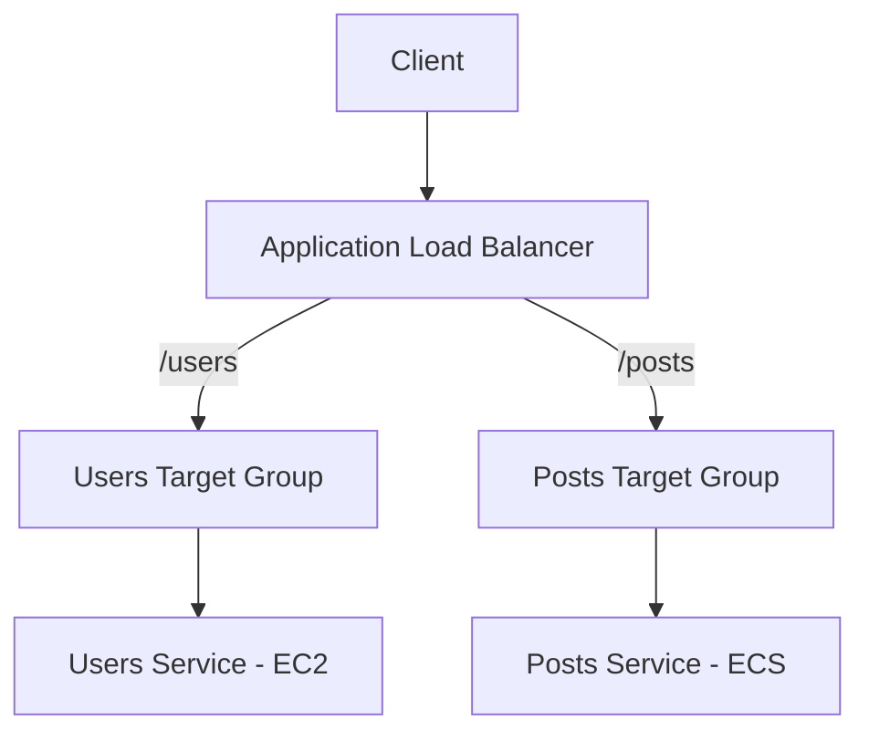

# AWS Elastic Load Balancing (ELB)

## 1. What Is Load Balancing?

**Load balancing** distributes incoming network traffic across multiple servers, such as EC2 instances, to improve performance, scalability, and availability.

Instead of users connecting directly to individual servers, they connect to a **Load Balancer**, which forwards requests to available servers.

### Benefits

- **Traffic distribution:** Spreads requests across multiple servers.
- **High availability:** Keeps applications accessible when individual servers fail.
- **Health checks:** Monitors servers and identifies unhealthy instances.
- **Single entry point:** Provides one DNS endpoint for accessing the application.
- **SSL/TLS termination:** Handles HTTPS encryption and decryption.
- **Session stickiness:** Uses cookies to direct a user's requests to the same server when needed.
- **Multi-AZ support:** Distributes traffic across Availability Zones to improve fault tolerance.
- **Public/private traffic:** Supports internet-facing and internal load balancing architectures.

## 2. AWS Elastic Load Balancing (ELB)

**Elastic Load Balancing (ELB)** is an AWS-managed service that automatically distributes incoming traffic across multiple targets.

AWS handles:

- Load balancer infrastructure and maintenance.
- Scaling load balancing capacity.
- High availability and infrastructure redundancy.
- Integration with other AWS services.

### AWS Integrations

- **EC2:** Virtual servers that process application requests.
- **Auto Scaling Groups:** Automatically add or remove EC2 instances based on demand.
- **Amazon ECS:** Runs containerized applications.
- **AWS Certificate Manager (ACM):** Manages SSL/TLS certificates.
- **Amazon CloudWatch:** Monitors metrics and performance.
- **Amazon Route 53:** Provides DNS routing.
- **AWS WAF:** Protects supported load balancers against common web attacks.
- **AWS Global Accelerator:** Improves global traffic routing.

You can configure your own load balancer using software such as NGINX, but you are responsible for its maintenance, scaling, and availability. A self-managed solution is not necessarily cheaper overall.

## 3. Types of AWS Load Balancers

AWS provides four main types of load balancers.

| Type | OSI Layer | Protocols | Main Use |
|---|---|---|---|
| Application Load Balancer (ALB) | Layer 7 | HTTP, HTTPS, WebSocket | Web applications, APIs, microservices |
| Network Load Balancer (NLB) | Layer 4 | TCP, UDP, TLS | High-performance network traffic |
| Gateway Load Balancer (GWLB) | Layer 3 | IP traffic using GENEVE encapsulation | Firewalls and network security appliances |
| Classic Load Balancer (CLB) | Layers 4 and 7 | HTTP, HTTPS, TCP, SSL | Legacy applications |

**Key differences:**

- **ALB:** Makes routing decisions using HTTP information, such as URL paths and headers.
- **NLB:** Routes network connections using transport-level information and supports very high performance.
- **GWLB:** Distributes traffic through network appliances such as firewalls.
- **CLB:** Previous-generation load balancer. New applications should generally use modern alternatives.

### Internal vs. Internet-Facing Load Balancers

- **Internet-facing:** Accepts traffic from clients over the internet.
- **Internal:** Provides private access to applications within connected private networks.

For example, a public ALB might receive requests from users, while an internal ALB distributes requests between backend services.

## 4. Health Checks

**Health checks** determine whether a target is healthy enough to receive requests.

A load balancer periodically checks registered targets and monitors their responses.

### How They Work

1. The load balancer sends a request to a configured endpoint.
2. The application responds with an HTTP status code.
3. The load balancer evaluates the response against configured success criteria.
4. If the target fails enough consecutive checks, it is marked unhealthy.
5. Traffic is normally routed to healthy targets.

### Example Configuration

```text
Protocol: HTTP
Port: 4567
Endpoint: /health
Expected status: 200 OK
```

Example application endpoint:

```javascript
app.get("/health", (req, res) => {
  res.status(200).json({ status: "healthy" });
});
```

**Important:**

- The default successful response code for an ALB HTTP health check is `200`, but the accepted success codes are configurable.
- Health checks are configured through target groups.
- A target becomes unhealthy after the configured failure threshold.
- When it recovers, it can receive traffic again after passing the required checks.
- If all targets are unhealthy, an ALB may still route requests to them (fail-open behavior).

## 5. Load Balancer Security Groups

**Security Groups** act as virtual firewalls that control incoming and outgoing network traffic.

A common architecture uses separate security groups for the load balancer and EC2 instances.

### Load Balancer Security Group

Allows incoming traffic from users.

| Protocol | Port | Source |
|---|---|---|
| HTTP | 80 | `0.0.0.0/0` |
| HTTPS | 443 | `0.0.0.0/0` |

`0.0.0.0/0` means all IPv4 addresses.

### EC2 Security Group

Allows application traffic only from the load balancer's security group.

| Protocol | Port | Source |
|---|---|---|
| HTTP | 80 | Load Balancer Security Group |

This prevents users from directly accessing the application through that port unless another rule permits it.

The load balancer must also have outbound access to the application's traffic and health-check ports.

**Best practice:** Allow public HTTPS access to the load balancer and restrict backend EC2 access to the load balancer's security group.

## 6. Application Load Balancer (ALB)

An **Application Load Balancer** operates at **Layer 7 (Application Layer)** of the OSI model.

It understands HTTP requests and can route them based on application-level information.

### Main Features

- Supports HTTP, HTTPS, HTTP/2, and WebSocket connections.
- Distributes traffic across multiple applications and servers.
- Supports HTTP-to-HTTPS redirects.
- Routes requests using URLs, hostnames, headers, and query parameters.
- Supports containerized applications, including Docker and Amazon ECS.
- Integrates with target groups for traffic routing and health checks.

### Request Routing

ALBs use **listener rules** to determine where requests should go.

| Routing Type | Example | Behavior |
|---|---|---|
| Path-based | `/users` | Routes to the users service |
| Path-based | `/posts` | Routes to the posts service |
| Host-based | `api.example.com` | Routes to an API service |
| Host-based | `admin.example.com` | Routes to an admin application |
| Query string | `?role=admin` | Routes based on query parameters |
| HTTP headers | `X-App-Version: v2` | Routes based on request headers |

### Example: Microservices



One ALB can route requests to different applications without requiring a separate load balancer for each service.

This makes ALBs particularly useful for **microservices architectures**.

### Dynamic Port Mapping

Amazon ECS can assign dynamic host ports to containers.

The ALB routes traffic to the appropriate registered target and port, allowing multiple containers to run on the same EC2 instance.

## 7. ALB Target Groups

A **Target Group** is a collection of resources that receive traffic from a load balancer.

ALBs route requests to target groups according to listener rules.

### Supported Target Types

| Target Type | Description |
|---|---|
| EC2 Instances | Virtual servers, including instances managed by Auto Scaling Groups |
| IP Addresses | Private IP addresses used as application endpoints |
| Lambda Functions | Serverless functions invoked through the ALB |

Amazon ECS tasks can be registered using instance or IP target types depending on their networking configuration.

For Lambda targets, the ALB translates HTTP requests into structured events passed to the function.

### Important Concepts

- One ALB can route traffic to multiple target groups.
- Each target group defines its own health-check configuration.
- Targets can be registered or deregistered as application capacity changes.
- Listener rules determine which target group receives a request.

**Listener:** Checks incoming requests on a configured protocol and port.

**Listener Rule:** Determines which action to take based on request conditions.

**Target Group:** Defines the backend resources that receive forwarded requests.

## 8. ALB DNS and Client IP Addresses

### DNS Endpoint

AWS assigns each ALB a DNS name similar to:

```text
my-alb-123456.us-east-1.elb.amazonaws.com
```

The DNS name stays associated with the load balancer while its underlying IP addresses can change.

You can configure a custom domain using Amazon Route 53 or another DNS provider.

### Client IP Forwarding

When an ALB forwards a request, the application typically sees the load balancer's private IP address as the immediate connection source instead of the client's IP.

To preserve information about the original request, the ALB uses HTTP headers.

| Header | Purpose |
|---|---|
| `X-Forwarded-For` | Contains client IP information |
| `X-Forwarded-Port` | Contains the client's destination port |
| `X-Forwarded-Proto` | Indicates the original HTTP or HTTPS protocol |

Example:

```http
X-Forwarded-For: 203.0.113.10
X-Forwarded-Port: 443
X-Forwarded-Proto: https
```

Applications should properly configure trusted proxies before relying on forwarded headers for security-sensitive operations.

## 9. SSL/TLS Termination

**SSL/TLS termination** allows a load balancer to handle HTTPS connections on behalf of application servers.

### How It Works

1. A client establishes an HTTPS connection with the ALB.
2. The ALB decrypts the incoming request.
3. The ALB forwards the request to a backend target using HTTP or HTTPS, depending on its configuration.
4. The application processes the request and returns a response.
5. The ALB sends the response back to the client over HTTPS.

### Benefits

- Reduces the need to manage certificates on every application server.
- Centralizes certificate management through AWS Certificate Manager.
- Simplifies HTTPS configuration for multiple backend services.

**Important:** TLS termination does not automatically encrypt traffic between the ALB and the backend. Configure HTTPS target connections when backend encryption is required.

## 10. Session Stickiness

**Session stickiness** makes requests from the same client go to the same backend target for a configured duration.

ALBs can implement stickiness using cookies.

### Example

A user logs in, and the application stores session information in the memory of EC2 Instance A.

Without stickiness, subsequent requests might reach EC2 Instance B, which does not contain that session information.

With stickiness enabled, the ALB attempts to route subsequent requests to Instance A.

### Considerations

- Useful for applications that depend on server-local session state.
- Can create uneven traffic distribution.
- Does not guarantee session availability if the target fails.

**Best practice:** Prefer shared session storage, such as Redis or a database, for scalable applications.

## 11. High Availability and Auto Scaling

Load balancing and Auto Scaling solve related but different problems.

| Service | Responsibility |
|---|---|
| Elastic Load Balancer | Distributes incoming traffic across available targets |
| EC2 Auto Scaling | Adjusts the number of EC2 instances based on capacity requirements |

### Example

1. An application starts with two EC2 instances across different Availability Zones.
2. Incoming traffic increases.
3. Auto Scaling launches additional instances.
4. The new instances register with the target group.
5. Once healthy, they can receive traffic from the ALB.
6. If an instance fails, healthy targets continue serving requests.

This combination improves **scalability, fault tolerance, and application availability**.

## 12. Key Concepts for AWS Certification

- **ELB:** AWS-managed service for distributing incoming traffic.
- **ALB:** Layer 7 load balancer used for HTTP-based applications.
- **NLB:** Layer 4 load balancer for high-performance TCP, UDP, and TLS traffic.
- **GWLB:** Layer 3 load balancer for network appliances.
- **CLB:** Legacy load balancer.
- **Health Checks:** Determine whether targets are available to receive traffic.
- **Target Groups:** Collections of backend resources receiving requests.
- **Listeners:** Accept incoming connections on configured protocols and ports.
- **Listener Rules:** Route requests according to specified conditions.
- **Security Groups:** Restrict access to the load balancer and application servers.
- **TLS Termination:** Handles HTTPS connections at the load balancer.
- **Session Stickiness:** Attempts to keep a client connected to the same backend target.
- **X-Forwarded-For:** Preserves client IP information through an HTTP header.
- **Multi-AZ:** Helps maintain availability when infrastructure in an Availability Zone fails.