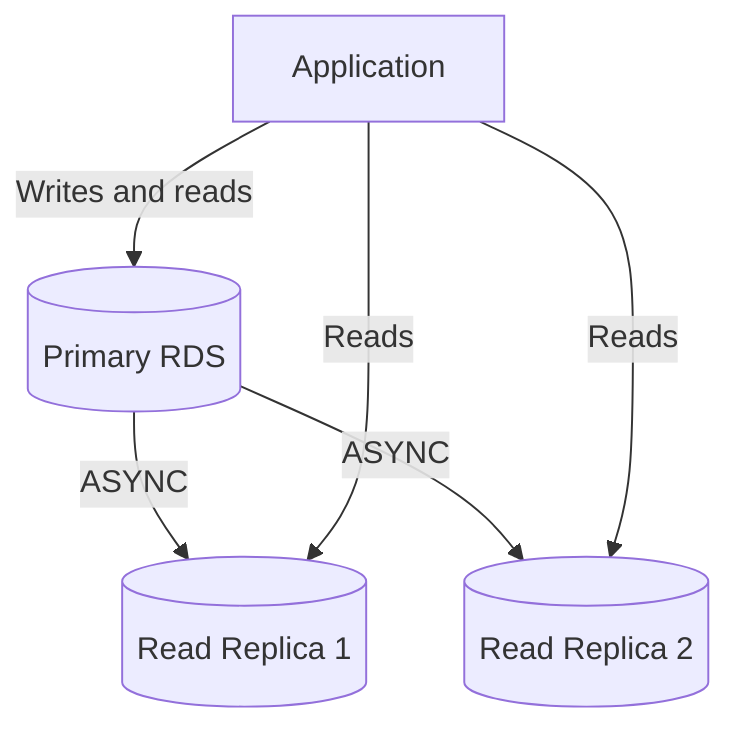
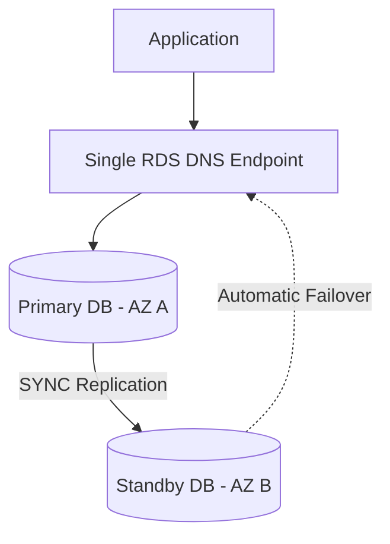
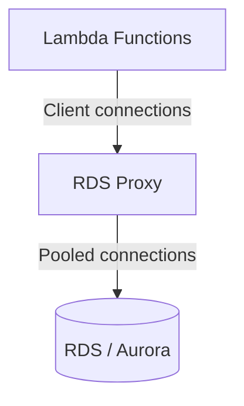
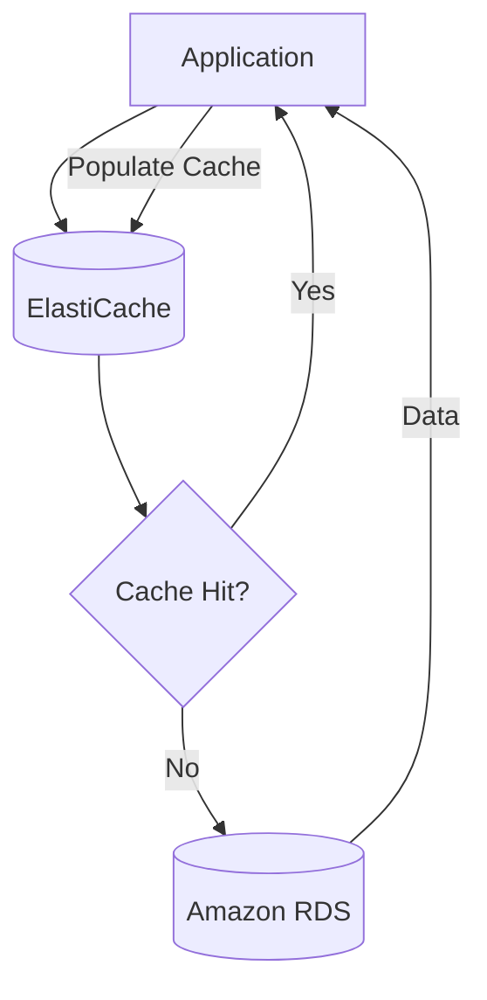
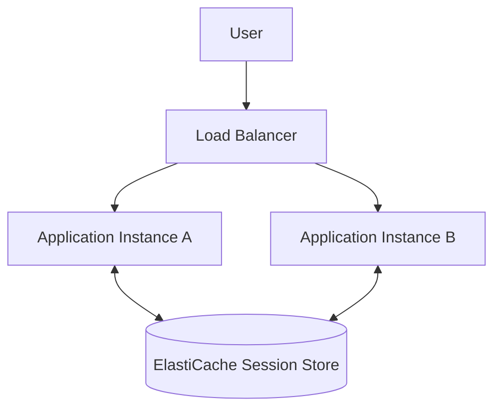
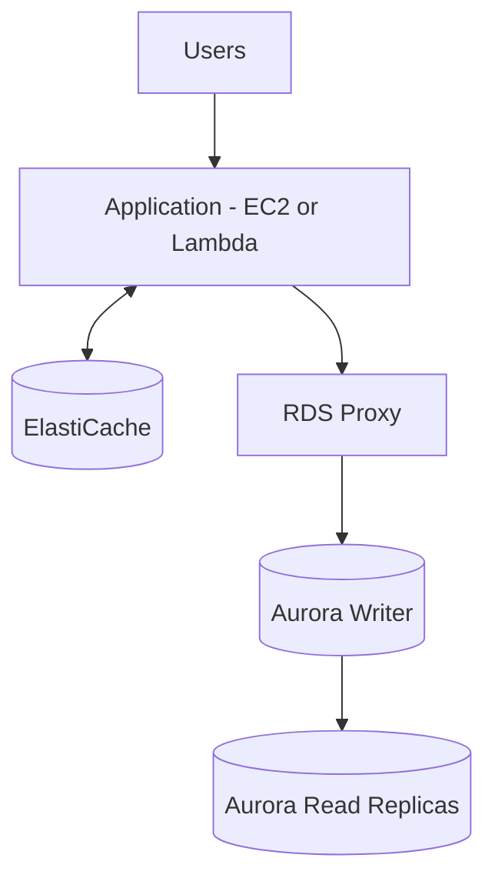

# Amazon RDS (Relational Database Service)

## 1. Overview

**Amazon RDS (Relational Database Service)** is a managed AWS service for deploying, operating, and scaling relational databases in the cloud.

Relational databases organize data into tables and use **SQL (Structured Query Language)** to query and manage data.

### Supported Database Engines

- PostgreSQL
- MySQL
- MariaDB
- Oracle Database
- Microsoft SQL Server
- IBM Db2
- Amazon Aurora (AWS-developed relational database compatible with MySQL and PostgreSQL)

### Benefits of RDS

AWS manages several database administration tasks:

- **Automated provisioning:** Creates and configures database infrastructure.
- **OS patching:** Maintains the underlying operating system.
- **Automated backups:** Supports recovery to a specific point in time.
- **Monitoring:** Provides performance metrics and monitoring dashboards.
- **Read Replicas:** Improves read scalability.
- **Multi-AZ:** Improves availability and disaster recovery.
- **Maintenance windows:** Schedules database maintenance and upgrades.
- **Scaling:** Supports changing compute capacity, storage growth, and additional read replicas.
- **Managed storage:** Standard RDS database instances generally use EBS-backed storage.

**Important:** Unlike databases installed on EC2, RDS does not provide SSH access to the underlying database servers.

## 2. RDS vs. Databases on EC2

| Feature | Amazon RDS | Database on EC2 |
|---|---|---|
| Infrastructure management | AWS-managed | User-managed |
| OS patching | AWS-managed | Manual |
| Backups | Built-in automation | Must configure |
| Monitoring | Integrated AWS tools | Must configure |
| Read Replicas | Managed functionality | Must configure |
| Multi-AZ failover | Managed functionality | Must implement |
| Database scaling | Simplified | Manual configuration |
| SSH access | No | Yes |

**Key difference:** RDS reduces database administration responsibilities, allowing developers to focus on applications instead of infrastructure.

## 3. RDS Storage Auto Scaling

**Storage Auto Scaling** automatically increases the allocated database storage when available space becomes low.

### How It Works

1. An application reads and writes data to RDS.
2. The database gradually consumes available storage.
3. RDS monitors free storage.
4. When the scaling conditions are met, RDS increases allocated storage.
5. The database continues operating with additional capacity.

### Scaling Conditions

RDS can automatically increase storage when:

- Free storage is below **10%** of allocated storage.
- Low storage persists for at least **5 minutes**.
- At least **6 hours** have passed since the last storage modification, or storage optimization has completed.
- The configured maximum storage threshold has not been reached.

### Important Characteristics

- You configure a **Maximum Storage Threshold**.
- Storage grows automatically within the configured limit.
- Useful for unpredictable database storage requirements.
- Supported by standard RDS database engines.
- Storage Auto Scaling increases storage capacity, not CPU or RAM.
- Automatically allocated storage cannot simply be scaled down afterward.

**Example:** A database with 100 GB of allocated storage approaches its capacity. RDS can automatically increase storage, up to the configured maximum.

## 4. RDS Read Replicas

**Read Replicas** are copies of a primary database designed to distribute read traffic and improve performance.

### How They Work

1. The primary database handles write operations.
2. Database changes are copied to the replicas.
3. Replicas handle additional read queries.
4. Applications connect to the appropriate database endpoint.

### Replication

Read Replicas generally use **asynchronous replication (ASYNC)**.

This means the primary database does not wait for every replica to receive changes before completing writes.

Consequently, replicas provide **eventual consistency**:

- Newly written data might not immediately appear on a replica.
- Replicas eventually receive the changes.
- The delay is called **replication lag**.

### Characteristics

- Standard RDS engines may support up to **15 Read Replicas**, depending on the engine.
- Replicas can exist within the same AZ, across AZs, or across Regions.
- Replicas typically handle read-only queries such as `SELECT`.
- Write operations such as `INSERT`, `UPDATE`, and `DELETE` go to the primary database.
- A Read Replica can be promoted to an independent database.
- Applications must route read traffic to replica endpoints, often using separate connection strings.

### Example Architecture



### Common Use Cases

**Reporting and analytics**

A production database handles normal application traffic, while a Read Replica handles expensive reporting queries.

Benefits:

- Reduces read workload on the primary database.
- Improves application read scalability.
- Separates reporting workloads from production operations.

**Important:** Read Replicas improve read scalability, not write scalability.

## 5. Read Replica Network Costs

AWS generally charges for data transfer between Availability Zones.

However, **RDS replication traffic between a primary database and its Read Replicas in the same AWS Region is free** for supported configurations.

| Replication Location | Replication Transfer Cost |
|---|---|
| Same AZ | No cross-AZ transfer |
| Different AZ, same Region | Free RDS replication transfer |
| Different Regions | Cross-Region transfer charges apply |

Other charges, including replica instance costs, storage costs, and applicable application traffic charges, may still apply.

**Key concept:** Cross-Region replication can introduce additional networking costs.

## 6. RDS Multi-AZ Deployment

**Multi-AZ (Multiple Availability Zones)** improves database availability and supports disaster recovery.

A traditional Multi-AZ DB instance deployment maintains a standby database in another Availability Zone.

### How It Works

1. The primary database handles application reads and writes.
2. Changes are synchronously replicated to the standby.
3. If the primary database fails, RDS can automatically switch to the standby.
4. The application continues using the same database endpoint.

### Replication

Multi-AZ standby replication uses **synchronous replication (SYNC)**.

The database coordinates writes with the standby to maintain consistent data.

### Example Architecture



### Benefits

- Higher availability.
- Automated failover.
- Protection against certain instance, storage, network, and AZ failures.
- No need to manually change application database connection strings during normal automatic failover.

### Important Characteristics

- Uses a consistent DNS endpoint.
- Applications may experience a temporary interruption during failover.
- Traditional Multi-AZ standby instances do not serve application read traffic.
- Designed for **high availability**, not read scaling.

**Note:** AWS also offers Multi-AZ DB cluster deployments with readable standby instances. The traditional Multi-AZ deployment described above uses a non-readable standby.

## 7. Read Replicas vs. Multi-AZ

| Feature | Read Replicas | Traditional Multi-AZ |
|---|---|---|
| Primary purpose | Read scalability | High availability |
| Replication | Asynchronous | Synchronous |
| Read traffic | Yes | Standby does not serve reads |
| Write traffic | Primary only | Primary only |
| Automatic failover | Not the main purpose | Yes |
| Cross-Region support | Yes | Traditional standby is within one Region |
| Consistency | Eventually consistent | Synchronous standby replication |
| Separate endpoints | Yes | Single database endpoint |

**Remember:**

- **Read Replicas = Performance and read scaling**
- **Multi-AZ = Availability and failover**

They can be combined to provide both scalability and high availability.

## 8. Converting Single-AZ to Multi-AZ

RDS allows an existing Single-AZ database deployment to be converted into a Multi-AZ deployment.

### Process

1. Open the RDS database configuration.
2. Select **Modify**.
3. Enable Multi-AZ deployment.
4. AWS creates a standby database in another Availability Zone.
5. The standby is synchronized with the primary database.

For traditional RDS DB instance conversions, AWS typically performs the following internally:

- Creates a snapshot of the primary database.
- Restores a standby database in another AZ.
- Establishes synchronous replication.

### Important Characteristics

- The database generally remains available during the conversion.
- The conversion does not require manually stopping the database.
- Performance may be affected during initialization.
- Once configured, RDS manages replication and automatic failover.

## 9. Key AWS Certification Concepts

- **RDS:** Managed relational database service.
- **Storage Auto Scaling:** Automatically increases database storage when capacity becomes low.
- **Read Replica:** Asynchronous copy used to scale reads.
- **Eventual Consistency:** Replicas may temporarily contain older data.
- **Replication Lag:** Delay between a primary write and the corresponding replica update.
- **Multi-AZ:** High-availability deployment with failover.
- **Synchronous Replication:** Coordinates writes with the standby before confirming completion.
- **Asynchronous Replication:** Replicates data without waiting for replicas to acknowledge every write.
- **Point-in-Time Recovery (PITR):** Restores a database to a supported timestamp within the backup retention period.
- **RDS Endpoint:** DNS address applications use to connect to the database.
- **Failover:** Switching database operations to another instance when the primary becomes unavailable.


# AWS Databases, Aurora, RDS Proxy & Caching

## 1. Amazon RDS Overview

**Amazon RDS (Relational Database Service)** is a managed AWS service for creating, operating, and scaling relational databases.

Relational databases organize information into tables and use SQL to query and manage data.

### Supported Database Engines

- PostgreSQL
- MySQL
- MariaDB
- Oracle Database
- Microsoft SQL Server
- IBM Db2
- Amazon Aurora (MySQL- and PostgreSQL-compatible)

### Benefits of RDS

AWS manages many database administration tasks:

- **Provisioning:** Creating and configuring database infrastructure.
- **OS patching:** Maintaining the underlying operating system.
- **Automated backups:** Supporting point-in-time recovery.
- **Monitoring:** Tracking database performance and health.
- **Read Replicas:** Scaling database reads.
- **Multi-AZ:** Increasing availability through automatic failover.
- **Maintenance windows:** Scheduling updates and maintenance.
- **Scaling:** Adjusting compute capacity and storage.

Standard RDS database instances generally use EBS-backed storage.

Unlike a database installed on EC2, RDS does not provide SSH access to the underlying server.

### RDS vs. Database on EC2

| Feature | Amazon RDS | Database on EC2 |
|---|---|---|
| Infrastructure | AWS-managed | User-managed |
| OS patching | AWS-managed | Manual |
| Automated backups | Built-in | Must configure |
| Monitoring | Integrated | Must configure |
| Read Replicas | Managed functionality | Must configure |
| Automatic failover | Multi-AZ support | Must implement |
| Scaling | Simplified | Manual |
| SSH access | No | Yes |

**Key concept:** RDS reduces database administration responsibilities, allowing developers to focus on applications.

---

## 2. RDS Storage Auto Scaling

**Storage Auto Scaling** automatically increases allocated database storage when available space becomes low.

### Scaling Conditions

RDS can increase storage when:

- Free storage falls below **10%** of allocated storage.
- Low storage persists for at least **5 minutes**.
- At least **6 hours** have passed since the last storage modification, or storage optimization has completed.
- The configured maximum storage threshold has not been reached.

### Characteristics

- Requires a maximum storage threshold.
- Useful for applications with unpredictable storage needs.
- Automatically increases storage without manual intervention.
- Does not increase CPU or RAM.
- Allocated storage cannot simply be automatically reduced afterward.

**Example:** A database with 100 GB of storage approaches capacity. RDS can automatically allocate additional storage without requiring an administrator to resize it manually.

---

## 3. RDS Read Replicas

**Read Replicas** are copies of a primary database used to distribute read traffic.

### How They Work

1. The primary database accepts writes and reads.
2. Database changes are copied asynchronously to replicas.
3. Replicas handle additional read queries.
4. The application routes read requests to replica endpoints.

### Characteristics

- Use **asynchronous replication (ASYNC)**.
- Provide **eventual consistency**.
- Can exist within one AZ, across AZs, or across Regions.
- Standard RDS engines can support up to 15 replicas, depending on the engine.
- Typically handle `SELECT` queries rather than writes.
- Can be promoted to independent databases.
- Require applications to route queries to the appropriate endpoints.

### Eventual Consistency

Because replication is asynchronous, replicas may temporarily contain older data.

The delay between a primary database update and its appearance on a replica is called **replication lag**.

### Common Use Case

A production database handles normal application traffic, while a Read Replica handles expensive reporting and analytics queries.

This prevents reporting workloads from overloading the primary database.

### Replication Network Costs

| Location | Replication Transfer Cost |
|---|---|
| Same AZ | No cross-AZ transfer |
| Different AZ, same Region | Free RDS replication transfer |
| Different Region | Cross-Region transfer charges |

Replica instances and storage still incur their own charges.

**Key concept:** Read Replicas improve read scalability, not write scalability.

---

## 4. RDS Multi-AZ Deployment

**Multi-AZ (Multiple Availability Zones)** increases availability by maintaining a standby database in another Availability Zone.

### How It Works

1. The primary database handles application traffic.
2. Changes are synchronously replicated to a standby.
3. If the primary fails, RDS can automatically promote the standby.
4. The application continues using the same database endpoint.

### Characteristics

- Uses **synchronous replication (SYNC)**.
- Protects against certain instance, storage, network, and AZ failures.
- Supports automatic failover.
- Uses a consistent DNS endpoint.
- Traditional Multi-AZ standby instances do not serve application reads.
- Failover may cause a temporary interruption.

AWS also offers Multi-AZ DB clusters with readable standby instances.

### Converting Single-AZ to Multi-AZ

An existing RDS instance can be modified into a traditional Multi-AZ deployment.

AWS generally:

1. Creates a snapshot of the primary database.
2. Restores a standby in another AZ.
3. Establishes synchronous replication.

The database generally remains available during conversion, although performance may temporarily be affected.

### Read Replicas vs. Traditional Multi-AZ

| Feature | Read Replicas | Multi-AZ |
|---|---|---|
| Purpose | Read scalability | High availability |
| Replication | Asynchronous | Synchronous |
| Read traffic | Yes | Standby: No |
| Automatic failover | Not primary purpose | Yes |
| Consistency | Eventually consistent | Synchronous replication |
| Separate endpoint | Yes | Single endpoint |

**Remember:**
- Read Replicas = Read performance.
- Multi-AZ = Availability and disaster recovery.

---

# 5. Amazon Aurora

**Amazon Aurora** is an AWS-developed, fully managed relational database engine optimized for cloud performance, scalability, and high availability.

Aurora is available through Amazon RDS but uses a different storage architecture from standard RDS databases.

### Database Compatibility

Aurora supports two database-compatible editions:

- **Aurora MySQL:** Compatible with MySQL.
- **Aurora PostgreSQL:** Compatible with PostgreSQL.

Applications can generally use existing MySQL or PostgreSQL drivers and SQL tools, subject to engine compatibility differences.

### Key Features

- AWS proprietary database technology.
- Cloud-optimized database architecture.
- High-performance relational database engine.
- Automatically expanding storage.
- Up to 15 Aurora Replicas.
- Built-in high availability.
- Automatic failover.
- Cross-Region replication.
- Managed backups and recovery.

### Performance

AWS advertises performance of up to:

- **5×** standard MySQL workloads.
- **3×** standard PostgreSQL workloads.

These are AWS benchmark claims, not guarantees for every application.

### Storage

Aurora storage:

- Automatically expands as data grows.
- Uses a distributed storage architecture.
- Can grow in approximately 10 GiB increments.
- Supports up to 256 TiB in supported configurations.
- Replicates data across multiple Availability Zones.

Unlike standard RDS instances, Aurora uses a distributed cluster storage volume shared by its database instances.

### Cost

Aurora may cost more than standard RDS because of its architecture and capabilities.

Actual cost depends on:

- Database instance types.
- Storage consumption.
- Database I/O.
- Number of replicas.
- Workload and pricing configuration.

The slide's approximately 20% higher cost is only a rough illustration, not a fixed pricing difference.

---

## 6. Aurora High Availability and Read Scaling

Aurora is designed to maintain availability even when some underlying storage components fail.

### Distributed Storage Architecture

Aurora traditionally maintains **six copies of database data across three Availability Zones**.

This means each AZ contains two storage copies.

### Storage Quorum

Aurora uses a quorum-based storage mechanism:

- **4 of 6 copies** are required for a write quorum.
- **3 of 6 copies** are required for a read quorum.

A **quorum** is the minimum number of storage replicas that must participate for an operation to succeed.

### Self-Healing Storage

Aurora automatically detects and repairs failed storage components.

Its distributed storage system:

- Replicates data across AZs.
- Repairs missing or damaged data copies.
- Distributes storage across many underlying storage segments.
- Expands storage as needed.

### Database Instances

An Aurora cluster typically contains:

- **One writer instance:** Handles database writes.
- **Up to 15 Aurora Replicas:** Handle additional reads and can serve as failover candidates.

Aurora Replicas share the underlying distributed storage volume rather than maintaining independent full storage copies in the same way as traditional RDS Read Replicas.

### Replication Lag

Aurora Replicas commonly have very low replication lag, often under 10 milliseconds.

However, actual lag depends on the workload and system conditions.

### Automatic Failover

If the writer becomes unavailable:

1. Aurora detects the failure.
2. An available replica can be promoted to writer.
3. The writer endpoint is redirected to the new writer.
4. Applications reconnect and resume operations.

Failover is not instantaneous. It often takes tens of seconds and can vary by configuration.

### Cross-Region Replication

Aurora supports cross-Region replication, including **Aurora Global Database**, which is designed for geographically distributed reads and disaster recovery.

---

## 7. Aurora Features

### Automatic Failover

Aurora can promote an existing replica when the writer fails, helping reduce downtime.

### Backup and Recovery

Aurora provides automated backups and point-in-time recovery.

### Security and Isolation

Aurora integrates with:

- Amazon VPC.
- IAM.
- Security Groups.
- AWS KMS.
- TLS encryption.

### Compliance

Aurora supports AWS compliance programs relevant to regulated workloads, with compliance depending on the applicable program, Region, and configuration.

### Scaling

Aurora supports:

- Changing database instance capacity.
- Adding or removing Aurora Replicas.
- Automatic storage growth.
- Aurora Serverless configurations for automatically adjusting compute capacity.

### Automated Patching

AWS manages database maintenance and patching.

Some maintenance operations can involve failover or brief interruptions, so zero downtime is not guaranteed.

### Monitoring

Aurora integrates with CloudWatch and other AWS database monitoring features.

### Aurora Backtrack

**Aurora Backtrack** allows supported Aurora MySQL configurations to rewind database changes to an earlier point without restoring a traditional backup.

Important characteristics:

- Available only for supported Aurora MySQL configurations.
- Must be configured appropriately.
- Rewinds the database cluster within its configured backtrack window.
- Does not replace the need for backups.
- Backtracking can interrupt database availability.

---

# 8. RDS and Aurora Security

Amazon RDS and Aurora provide several layers of database security.

## Encryption at Rest

**Encryption at rest** protects stored database data.

AWS KMS (Key Management Service) is used to manage encryption keys.

Encryption can cover:

- Database storage.
- Automated backups.
- Snapshots.
- Read Replicas.

### Important Rules

- Encryption is normally configured when creating a database.
- An unencrypted standard RDS database cannot simply have storage encryption enabled in place.
- To encrypt an existing unencrypted database, create a snapshot, copy it with encryption enabled, and restore it.
- Read Replica encryption requirements depend on the primary database and Region configuration.

## Encryption in Transit

**Encryption in transit** protects information moving between applications and databases.

RDS and Aurora support TLS (Transport Layer Security).

Applications can validate database server certificates using AWS-provided certificate authorities.

TLS support does not mean every client connection automatically enforces encryption; enforcement depends on configuration.

## IAM Database Authentication

Supported engines allow applications to authenticate using IAM-generated authentication tokens instead of long-lived database passwords.

IAM policies control which identities can connect.

Database authorization still controls what authenticated users can do.

## Security Groups

Security Groups act as virtual firewalls.

They control which network sources can access database instances.

Example:

- Application Security Group allows outbound database traffic.
- Database Security Group permits inbound traffic from the application's Security Group on the database port.

## SSH Access

Standard RDS and Aurora databases do not provide SSH access to their underlying hosts.

**RDS Custom** provides additional operating system access for supported database engines.

## Audit Logging

Supported database logs can be exported to Amazon CloudWatch Logs for:

- Monitoring database activity.
- Investigating issues.
- Auditing operations.
- Retaining supported logs for longer periods.

---

# 9. Amazon RDS Proxy

A **proxy** is an intermediary that receives requests from clients and forwards them to another service.

**Amazon RDS Proxy** is a fully managed database proxy that sits between applications and supported RDS or Aurora databases.

Its primary purpose is to manage database connections efficiently.

## Connection Pooling

Database connections consume resources such as CPU and RAM.

Opening thousands of database connections can overload a database server.

RDS Proxy addresses this through **connection pooling**.

Connection pooling means maintaining and reusing a collection of database connections rather than creating a new connection for every application request.

### How It Works

1. Applications connect to RDS Proxy.
2. The proxy maintains a pool of database connections.
3. Multiple application clients reuse those connections when possible.
4. The proxy forwards database operations to RDS or Aurora.

### Benefits

- Reduces connection creation overhead.
- Helps prevent excessive database connection counts.
- Improves scalability for applications with many short-lived connections.
- Reduces connection-related CPU and memory pressure.
- Helps applications handle database failovers.
- Can reduce database connection timeouts.

## RDS Proxy Characteristics

- Fully managed by AWS.
- Automatically scales proxy capacity.
- Highly available across multiple AZs.
- Supports supported RDS and Aurora engines.
- Often requires minimal application changes, such as using the proxy endpoint.
- Integrates with AWS Secrets Manager.
- Supports IAM authentication.
- Accessible through VPC networking, not as a public internet endpoint.

Supported engines include configurations of MySQL, PostgreSQL, MariaDB, SQL Server, Aurora MySQL, and Aurora PostgreSQL.

Engine and feature support should be checked for the selected configuration.

## RDS Proxy and Lambda

AWS Lambda functions can scale rapidly, creating many concurrent execution environments.

Without connection pooling, each execution environment might open its own database connections.

RDS Proxy allows these functions to share an efficiently managed pool of connections.

### Architecture



## Failover

RDS Proxy helps applications maintain connectivity during database failover.

It can reduce connection recovery time and avoid some application-side DNS handling.

However, it does not eliminate all interruptions or guarantee that active transactions survive failover.

**Key concept:** RDS Proxy improves connection management; it does not cache SQL query results.

---

# 10. Amazon ElastiCache

**Amazon ElastiCache** is a managed AWS service for running high-performance, in-memory caches and data stores.

It supports cache engines such as:

- Redis OSS.
- Valkey.
- Memcached.

Valkey is an open-source, Redis-compatible engine.

## What Is Caching?

**Caching** means temporarily storing frequently requested information in a faster storage layer.

Instead of repeatedly querying a relational database, an application retrieves previously stored data from memory.

### Benefits

- Lower latency.
- Faster response times.
- Reduced database load.
- Higher read throughput.
- Improved application scalability.

### Why In-Memory Is Fast

Traditional databases often rely on persistent disk-backed storage.

In-memory caches primarily use RAM, which provides very fast data access.

However, cache contents may be lost or unavailable depending on the engine and persistence configuration.

## Managed ElastiCache Features

Depending on the engine and deployment mode, AWS manages:

- Provisioning.
- Infrastructure maintenance.
- Patching.
- Monitoring.
- Failure recovery.
- Backup functionality.
- Scaling capabilities.

## Application Integration

ElastiCache typically requires application-level caching logic.

Developers must decide:

- What data to cache.
- When to populate the cache.
- When to refresh or invalidate entries.
- How to handle cache failures.
- How long cached entries remain valid.

---

# 11. ElastiCache as a Database Cache

A common architecture places ElastiCache between the application and the relational database.

### Cache Hit

A **cache hit** occurs when requested data already exists in the cache.

The application retrieves it directly without querying RDS.

### Cache Miss

A **cache miss** occurs when requested data is unavailable in the cache.

The application:

1. Checks the cache.
2. Finds no matching entry.
3. Queries RDS.
4. Stores the result in ElastiCache.
5. Returns the data.



This design reduces repeated database reads.

### Cache Invalidation

**Cache invalidation** means deleting or updating cached information when it becomes outdated.

Without proper invalidation, an application might continue displaying stale data.

Example:

- A user changes their profile name.
- The database stores the new name.
- The cache still contains the old name.
- The cached value must be updated, removed, or allowed to expire.

---

# 12. ElastiCache as a User Session Store

ElastiCache can store user session data in a centralized location.

This is particularly useful when applications run on multiple servers.

## How It Works

1. A user logs into an application.
2. The application creates session data.
3. The session is stored in ElastiCache.
4. The user's next request reaches another application instance.
5. The new instance retrieves the session from ElastiCache.
6. The application recognizes the user's existing session.

### Architecture



### Benefits

- Sessions are accessible across application instances.
- Supports horizontal scaling.
- Reduces dependence on a specific application server.
- Helps create **stateless application servers**.

A stateless application server does not depend on locally stored session information between requests.

The application can still use session state, but that state is stored externally.

**Important:** If session data must survive infrastructure failures, configure appropriate availability and durability mechanisms.

---

# 13. Caching Implementation Considerations

Before implementing caching, consider the data characteristics and application requirements.

## Data Freshness

Cached information may become outdated.

Caching is most appropriate when temporary staleness is acceptable or the application can reliably invalidate outdated entries.

## Effective Caching Patterns

Caching works particularly well for:

- Frequently accessed information.
- Data that changes infrequently.
- Expensive database queries.
- Aggregated query results.
- Repeated requests for a relatively small number of keys.

Examples:

- Product catalogs.
- User profiles.
- Frequently visited articles.
- Leaderboards.
- Dashboard summaries.

## Poor Caching Candidates

Caching may be less effective when:

- Data changes extremely frequently.
- Every request accesses different data.
- Most keys are accessed only once.
- Strict consistency is required.
- Cache maintenance costs exceed the performance benefits.

## Data Structure

Key-value storage is especially convenient for caching.

Example:

```text
Key: user:123
Value: {"name":"Alex","role":"admin"}
```

Other useful cached structures include counters, sorted sets, and aggregated query results.

---

# 14. Lazy Loading / Cache-Aside

**Lazy Loading**, also called **Cache-Aside** or **Lazy Population**, populates the cache only when an application requests data.

## How It Works

1. The application requests an item from the cache.
2. If the item exists, return it.
3. If the item does not exist, query the database.
4. Store the database result in the cache.
5. Return the result to the application.

### Advantages

- Only requested data is cached.
- Avoids filling memory with unnecessary information.
- Simple to implement.
- Cache failures can be handled by querying the database.
- Useful for many read-heavy applications.

### Disadvantages

- Cache misses introduce additional latency.
- The cache starts empty and must gradually warm up.
- Cached data can become stale.
- A sudden increase in cache misses can overload the database.

### Example

A product page receives thousands of requests.

The first request loads the product from RDS and stores it in ElastiCache.

Subsequent requests retrieve the product from memory.

**Key concept:** Lazy Loading populates the cache when data is first requested.

---

# 15. Write-Through Caching

**Write-Through Caching** updates the cache when application data is written to the database.

## How It Works

In a common application-managed implementation:

1. The application writes data to the database.
2. The application updates the corresponding cache entry.
3. Subsequent reads can retrieve the updated cached value.

The application must handle failures between database and cache updates.

### Advantages

- Frequently updated entries can already be available in the cache.
- Reduces cache misses after writes.
- Helps keep cached information synchronized when implemented correctly.

### Disadvantages

- Each write may require additional operations.
- Adds write overhead.
- May cache information that is never read.
- Does not automatically guarantee perfect consistency.
- May cause **cache churn**.

### Cache Churn

Cache churn happens when cached entries are frequently inserted, updated, or removed without providing meaningful reuse.

This wastes memory and processing resources.

### Common Strategy

Combine Write-Through with Lazy Loading:

- Write-Through keeps selected entries updated.
- Lazy Loading populates entries that are missing.

**Key concept:** Write-Through updates cached data during the write workflow, while Lazy Loading populates data on demand.

---

# 16. Cache Eviction and TTL

**Cache eviction** means removing entries from the cache.

Entries can be removed in several ways.

## Explicit Deletion

The application manually deletes an entry.

Example:

```text
DELETE user:123
```

This is useful when data changes and the previous cached value becomes invalid.

## Memory-Based Eviction

When memory becomes full, the cache may remove entries according to its configured eviction policy.

A common policy is **LRU (Least Recently Used)**.

LRU removes entries that have not been accessed recently.

Other supported eviction policies may consider frequency, expiration, or other rules.

## Time-to-Live (TTL)

**TTL (Time-to-Live)** defines how long an entry remains valid before expiring.

Example:

```text
Key: leaderboard:weekly
TTL: 300 seconds
```

After five minutes, the cached entry expires and a subsequent request may need to retrieve fresh data.

### TTL Use Cases

- Leaderboards.
- Comments.
- Activity feeds.
- User profiles.
- Product information.
- Aggregated results.

TTL values can range from seconds to hours or days.

The appropriate duration depends on how frequently data changes and how much staleness the application can tolerate.

### Important Considerations

- A short TTL improves freshness but increases database requests.
- A long TTL improves cache reuse but increases the risk of stale data.
- Too many memory-related evictions can indicate insufficient capacity.
- Frequent evictions may require scaling the cache or improving the eviction strategy.

---

# 17. Caching Best Practices

### Prefer Cache-Aside as a Starting Point

Cache-Aside is relatively simple and works well for many read-heavy applications.

### Combine Strategies When Appropriate

Write-Through can complement Cache-Aside for selected workloads.

### Use TTL Carefully

TTL helps bound the lifetime of stale information but does not guarantee immediate consistency.

### Cache Selectively

Good candidates include:

- User profiles.
- Frequently accessed content.
- Product information.
- Repeated query results.

Avoid caching everything without considering memory usage and update frequency.

### Plan for Cache Failures

Applications should define fallback behavior when caching infrastructure becomes unavailable.

### Monitor Cache Performance

Useful metrics include:

- Cache hit rate.
- Cache miss rate.
- Memory utilization.
- Eviction count.
- CPU usage.
- Cache latency.

**Key principle:** Caching improves performance only when its benefits justify the added complexity and consistency trade-offs.

---

# 18. Amazon MemoryDB

**Amazon MemoryDB** is a managed, durable, in-memory database service designed for high performance.

It differs from a traditional cache because it is designed to store durable application data, rather than merely temporary copies of another database's information.

### Characteristics

- Redis-compatible data access capabilities.
- Very low-latency, in-memory performance.
- Durable storage using a distributed transactional log.
- Multi-AZ architecture.
- Automated recovery.
- Supports large-scale, high-throughput workloads.

AWS has advertised throughput exceeding 160 million requests per second in particular large-scale benchmark configurations; this is not a guarantee for individual deployments.

### Durability

MemoryDB stores data in memory for fast access while maintaining a durable transactional log across multiple Availability Zones.

This allows the database to recover data after supported failures.

### Scaling

MemoryDB supports scaling its compute and storage capacity using a distributed architecture.

### Common Use Cases

- Web applications.
- Mobile applications.
- Online gaming.
- Real-time user activity.
- Media streaming.
- Low-latency microservices.
- Applications requiring a durable in-memory data store.

---

# 19. ElastiCache vs. MemoryDB

| Feature | ElastiCache | MemoryDB |
|---|---|---|
| Primary purpose | Caching | Durable in-memory database |
| Data role | Frequently temporary copies | Primary application data |
| Performance | Very low latency | Very low latency |
| Durability | Depends on engine/configuration | Durable transactional log |
| Common use | Database cache | Durable low-latency data store |
| Session storage | Yes | Possible |
| Data recovery | Configuration-dependent | Built-in durable architecture |

### Choosing Between Them

**Choose ElastiCache when:**
- You need to reduce database read traffic.
- Your primary data is stored in RDS or Aurora.
- You need a fast cache or session store.

**Choose MemoryDB when:**
- You need an in-memory database as a durable system of record.
- Losing cached-only data is unacceptable.
- Your workload requires very low latency and durable storage.

---

# 20. AWS Database Services Comparison

| Service | Primary Purpose | Main Benefit |
|---|---|---|
| RDS | Managed relational database | Simplified database administration |
| Aurora | Cloud-optimized relational database | Scalability, performance, high availability |
| RDS Read Replica | Read scaling | Distributes read traffic |
| RDS Multi-AZ | High availability | Automatic failover |
| RDS Proxy | Connection management | Connection pooling |
| ElastiCache | In-memory caching | Faster reads, reduced database load |
| MemoryDB | Durable in-memory database | Fast access with durable storage |

## Example Application Architecture

A scalable AWS application might use:

- **EC2 or Lambda:** Executes application code.
- **RDS Proxy:** Manages database connections.
- **Aurora:** Stores relational application data.
- **Aurora Replicas:** Handles additional database reads.
- **ElastiCache:** Caches frequently requested information.
- **CloudWatch:** Monitors infrastructure and database performance.



The diagram is simplified. Applications can also route read workloads to Aurora's reader endpoint, and RDS Proxy can be configured with supported read-only endpoints.

---

# 21. AWS Developer Associate — Key Concepts

- **RDS:** Managed relational database service.
- **Aurora:** AWS-developed relational database engine with distributed storage.
- **Aurora Storage:** Six data copies across three AZs in its traditional storage architecture.
- **Aurora Quorum:** Four copies for write quorum, three for read quorum.
- **Aurora Replicas:** Up to 15 readers sharing cluster storage.
- **RDS Read Replica:** Asynchronous replication for read scaling.
- **Multi-AZ:** High availability through standby infrastructure and automatic failover.
- **RDS Proxy:** Connection pooling and improved database connection management.
- **ElastiCache:** Managed in-memory caching.
- **MemoryDB:** Durable in-memory database.
- **Cache Hit:** Requested data is found in the cache.
- **Cache Miss:** Requested data is absent from the cache.
- **Cache-Aside:** Fetch from the database and populate cache on demand.
- **Write-Through:** Update the cache as part of the database write workflow.
- **TTL:** Time before a cached entry expires.
- **LRU:** Evicts the least recently accessed entries when configured.
- **Cache Invalidation:** Removes or refreshes outdated cached entries.
- **IAM Authentication:** Uses IAM-generated database authentication tokens for supported engines.
- **KMS:** Manages encryption keys used to protect data at rest.
- **TLS:** Protects database connections in transit.
- **Security Groups:** Control network access to databases.
- **CloudWatch:** Monitors database and cache health.

## Essential Distinctions

| Requirement | AWS Solution |
|---|---|
| Managed SQL database | RDS |
| Cloud-optimized SQL database | Aurora |
| More database read capacity | Read Replicas |
| Automatic database failover | Multi-AZ |
| Too many database connections | RDS Proxy |
| Frequent repeated database reads | ElastiCache |
| Shared user sessions across servers | ElastiCache |
| Durable, low-latency in-memory storage | MemoryDB |
| Protection of stored database data | AWS KMS encryption |
| Protection of database traffic | TLS |
| Restrict database network access | Security Groups |
| Automatically expire cached data | TTL |
| Remove stale cached data | Cache invalidation |

    